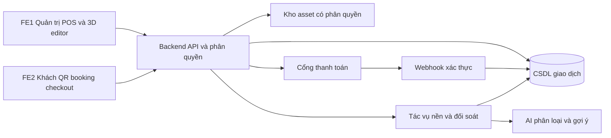

# MVP quản lý quán cafe và coworking bằng không gian 3D

Phiên bản 0.1 — ngày 14/11/2026 — Bản đề xuất để đội phát triển và chủ quán chốt nghiệp vụ.

Mục tiêu đã thống nhất: pilot vận hành tại 1–2 quán trong 10–12 tuần với 1 BE và 2 FE. Sản phẩm cho phép bán đồ uống, giờ sử dụng chỗ ngồi và dịch vụ kèm theo; khách đặt chỗ, tự thanh toán tại bàn; quán quản lý hoạt động trên sơ đồ 3D. White-label cho phép dùng chung sản phẩm với thương hiệu và dữ liệu riêng. AI hỗ trợ phân loại yêu cầu, đề xuất giá và ưu đãi; các quyết định làm thay đổi tiền hoặc quyền sử dụng chỗ vẫn theo quy tắc nghiệp vụ được kiểm soát.

## 1. Quyết định phạm vi

### 1.1 Ba phương án

| Phương án | Nội dung | Đánh đổi |
| --- | --- | --- |
| Demo 4–6 tuần | 3D, giỏ hàng và tình huống AI với dữ liệu mô phỏng | Phù hợp trình diễn; chưa đủ để vận hành thu tiền |
| Pilot 10–12 tuần — đã chọn | POS cơ bản, thanh toán thật, booking, 3D cơ bản, tách dữ liệu nhiều quán, AI hỗ trợ có kiểm soát | Giới hạn trình dựng 3D, tích hợp và tự động hóa |
| Thương mại nhiều quán | Thêm kế toán, vận hành ngoại tuyến, thiết bị POS, SLA, dự báo và tự động tối ưu | Cần giai đoạn và nguồn lực bổ sung |

### 1.2 Giả định lập kế hoạch

- Ba lập trình viên làm toàn thời gian; không có QA, designer, data engineer riêng. FE1 điều phối UI dùng chung; cả đội chia nhau kiểm thử.
- Chủ sản phẩm/chủ quán cung cấp menu, giá, quy trình vận hành, thương hiệu và người UAT; cần đầu mối quyết định trong một ngày làm việc.
- Pilot 1–2 quán, mỗi quán một chi nhánh; mô hình dữ liệu vẫn có tenant và branch để tránh phải đổi nền tảng khi mở rộng.
- Để kiểm chứng cách ly dữ liệu, UAT có hai tenant độc lập, kể cả khi hai quán pilot cùng một chủ.
- Web responsive: máy tính/tablet cho nhân viên, điện thoại cho khách; chưa làm ứng dụng native.
- Mỗi tenant dùng một tiền tệ; mỗi chi nhánh có múi giờ và giờ mở cửa. Số tiền lưu dạng số nguyên theo đơn vị tiền tệ nhỏ nhất, thời điểm lưu UTC.
- Một cổng thanh toán có môi trường thử nghiệm, callback/webhook và khả năng truy vấn trạng thái; tiền mặt chỉ do nhân viên xác nhận. Chọn nhà cung cấp ở tuần 1.
- Mỗi reservation có một người sở hữu và giữ một chỗ ngồi; nhóm nhiều người dùng nhiều chỗ được xử lý thủ công ở pilot.
- Asset 3D do đội/chủ quán cung cấp từ nguồn có quyền sử dụng. Không có nhân sự dựng model riêng trong ước lượng.
- 10 tuần xây dựng và UAT; tuần 11–12 dành cho pilot và sửa lỗi. Đây là ước lượng cần xác nhận lại sau tuần 1 và tuần 4.

### 1.3 Phạm vi ưu tiên

| Mảng | Phải có để pilot | Bổ sung sau khi luồng cốt lõi ổn định | Sau MVP |
| --- | --- | --- | --- |
| POS | Menu, lựa chọn size, đồ uống/dịch vụ/giờ bàn, giỏ hàng, trả trước, tiền mặt/online, trạng thái phục vụ, đối soát ca | Tổng hợp bán hàng theo nhóm hàng | Kho nguyên liệu, định lượng, hóa đơn điện tử, kế toán, chia bill, công nợ |
| 3D | Xem mặt bằng, chọn chỗ, trạng thái; editor kéo/xoay/snap asset, lưu nháp và xuất bản; chế độ danh sách/2D | Tối ưu asset theo dữ liệu thiết bị pilot | Dựng kiến trúc tự do, scan không gian, VR/AR, multiplayer editor |
| White-label | Tenant độc lập; logo, màu, tên, menu, giá, layout riêng; đường dẫn theo quán | Bộ mẫu cấu hình khi tạo quán | Custom domain, app riêng từng thương hiệu, marketplace asset |
| Self checkout | QR, giỏ hàng, báo giá, thanh toán, theo dõi đơn và gọi nhân viên | AI đọc ghi chú để phân loại hỗ trợ | AI tự hoàn tiền, tự xử lý tranh chấp, nhận diện khách qua camera |
| Booking | Đặt trước chỗ cụ thể, hold, trả trước, check-in/out, gia hạn, chặn trùng lịch | Báo cáo công suất | Đặt nhóm, membership không giới hạn, đồng bộ lịch bên ngoài |
| Pricing | Giá theo khu vực/khung giờ; lịch hiệu lực; quản lý duyệt đề xuất flash sale | AI giải thích đề xuất từ dữ liệu tổng hợp | AI tự đổi giá, cá nhân hóa giá theo từng khách, mô hình dự báo riêng |
| Loyalty | Tích điểm, đổi ưu đãi theo quy tắc, khách đồng ý tham gia, thống kê hành vi cơ bản | AI diễn giải xu hướng và gợi ý ưu đãi cho quản lý | Huấn luyện mô hình riêng, dự đoán churn, chiến dịch đa kênh tự động |

AI phân loại yêu cầu, đề xuất pricing và đề xuất loyalty đều được triển khai ở mức nhỏ trong đợt pilot; thứ tự thực hiện đứng sau khả năng đặt chỗ và thu tiền an toàn. Nếu phải giảm phạm vi, cắt độ phong phú của AI trước, giữ các quy tắc và luồng vận hành tương ứng.

## 2. Người dùng và giá trị

| Nhóm | Công việc chính | Kết quả mong muốn |
| --- | --- | --- |
| Chủ thương hiệu | Quản lý người dùng, thương hiệu, chính sách giá/loyalty, xem kết quả toàn tenant | Dùng chung sản phẩm cho các quán và kiểm soát quyền |
| Quản lý quán | Điều phối chỗ ngồi, giá, layout, đơn và xử lý ngoại lệ | Nắm công suất và xử lý vận hành ở một nơi |
| Thu ngân | Tạo đơn, thu tiền, check-in/out, đối soát ca | Thu đúng tiền, hạn chế nhập lại |
| Nhân viên phục vụ | Xem phiếu cần làm, nhận yêu cầu hỗ trợ, cập nhật phục vụ | Biết bàn nào cần gì và mức ưu tiên |
| Khách | Chọn chỗ, mua giờ, đặt món, thanh toán, xem đơn của mình | Tự phục vụ nhanh; gọi người hỗ trợ khi cần |
| Quản trị nền tảng | Tạo tenant, quản lý tài khoản sở hữu, hỗ trợ kỹ thuật | Vận hành hệ thống nhiều tenant có nhật ký truy cập |

## 3. Luồng nghiệp vụ và tiêu chí nghiệm thu

### FR01 — Tenant, thương hiệu và phân quyền

Mỗi tenant có thương hiệu, người dùng, menu, khách hàng, giá, layout và báo cáo riêng. Nhân sự được gán vai trò và phạm vi chi nhánh. UI tải cấu hình thương hiệu theo đường dẫn của quán; cấu hình chỉ gồm giá trị đã kiểm tra, không cho chèn mã tùy ý.

- KHI tạo quán mới từ mẫu, THÌ quán có menu/layout cấu hình độc lập; sửa mẫu hoặc quán A không làm thay đổi quán B.
- KHI người của tenant A gửi API bằng ID tài nguyên tenant B, THÌ hệ thống từ chối và không tiết lộ nội dung tài nguyên.
- KHI thu hồi quyền nhân viên, THÌ API nhạy cảm từ phiên hiện tại bị chặn ở lần gọi tiếp theo; không chỉ ẩn nút trên UI.
- KHI nhân viên chỉ được gán branch A, THÌ không đọc/sửa được đơn, ca và booking của branch B trong cùng tenant.

### FR02 — POS đồ uống, giờ bàn và dịch vụ

Danh mục gồm đồ uống/đồ ăn, gói giờ ngồi và dịch vụ cố định như thuê màn hình hoặc phòng phụ trợ. Dịch vụ giới hạn số lượng được nhân viên xác nhận còn khả dụng; MVP chưa có bộ lập lịch tài nguyên riêng cho thiết bị/phòng. Menu có trạng thái còn bán/hết món; không quản lý tồn kho nguyên liệu.

- Đơn có các dòng hàng, lựa chọn size, số lượng, giá chụp tại thời điểm báo giá, giảm giá, phí và tổng tiền. Phí/thuế nếu áp dụng phải được chủ quán cấu hình trước pilot và hiển thị trước thanh toán; chưa tích hợp hóa đơn điện tử.
- Giờ ngồi bán trả trước, tối thiểu 30 phút và tăng theo bước 30 phút. Đặt trước chọn giờ bắt đầu theo bước 15 phút; walk-in dùng giờ máy chủ tại thời điểm xác nhận.
- Không cộng dồn ưu đãi: mỗi đơn tối đa một ưu đãi, áp trên dòng đủ điều kiện và có trần. Không đồng thời áp flash sale và voucher/đổi điểm cho cùng đơn.
- KHI xác nhận tiền mặt, THÌ chỉ thu ngân/quản lý có quyền mới đánh dấu đã thu và phải ghi nhận ca thu ngân.
- KHI khách thanh toán online thành công, THÌ server xác thực bằng nhà cung cấp; màn hình khách không có quyền tự đánh dấu đã trả.
- KHI nhân viên gửi yêu cầu tạo/thu tiền lặp do mạng chập chờn, THÌ cùng khóa idempotency chỉ tạo một kết quả nghiệp vụ.
- KHI đơn có món và giờ ngồi, THÌ món được chuyển phục vụ sau khi trả tiền; quyền dùng chỗ chỉ kích hoạt khi reservation được xác nhận thành công.

### FR03 — Không gian 3D và asset

Chi nhánh có khu vực và chỗ ngồi bán được (`Seat`); bàn/model trang trí là asset. Một bàn có thể có nhiều Seat. Hệ thống đặt chỗ và tính giá theo Seat; di chuyển asset không đổi ID của Seat hoặc lịch đặt.

- Editor cho quản lý chọn asset từ thư viện, kéo/xoay, đặt trên sàn, snap vào lưới, gắn Seat, lưu draft, preview và publish phiên bản layout.
- Pilot dùng thư viện GLB/glTF đã duyệt; upload tùy ý bởi quán chưa thuộc MVP. Asset thuộc thư viện chung hoặc tenant cụ thể, tham chiếu theo phiên bản và có kiểm tra quyền truy cập.
- Asset trang trí khác với Seat bán được. Trạng thái Seat: trống, đang giữ chỗ, đã đặt, đang sử dụng, dọn dẹp hoặc khóa thủ công.
- KHI publish layout, THÌ server kiểm tra Seat ID hợp lệ/duy nhất, vị trí nằm trong sàn và không loại bỏ chỗ còn booking chưa kết thúc; có thể lưu draft để xử lý sau.
- KHI hai quản lý cùng sửa, THÌ optimistic version ngăn người lưu sau ghi đè âm thầm.
- KHI WebGL không khả dụng hoặc thiết bị yếu, THÌ khách/nhân viên vẫn xem danh sách/2D, chọn chỗ và hoàn thành đặt mua.
- KHI khách xem sơ đồ công khai, THÌ chỉ thấy trạng thái khả dụng; không thấy tên, số điện thoại hoặc đơn của người đang ngồi.

### FR04 — Booking, phiên sử dụng và gia hạn

Một booking giữ đúng một Seat trong khoảng thời gian xác định; phiên sử dụng (`Session`) ghi nhận check-in/out thực tế. Thời gian tính tiền dựa trên gói đã mua; không tự thu thêm khi quá giờ ở MVP.

1. Khách/thu ngân chọn chỗ, ngày giờ, thời lượng; server tính khả dụng và báo giá.
2. Server tạo hold 5 phút, trả hạn thanh toán. Hold đang hiệu lực chặn đặt trùng.
3. Thanh toán thành công và hold còn hợp lệ → xác nhận booking. Giá trị tiền và hiệu lực phải được kiểm tra ở server.
4. Thu ngân hoặc khách sở hữu booking check-in từ giờ bắt đầu đến 15 phút sau giờ bắt đầu. Khách đến sớm có thể xem booking nhưng chưa tự kích hoạt giờ sử dụng. Nếu quán chưa thể bàn giao chỗ thì chuyển nhân viên, không tự check-in đè khách đang dùng; đặt trạng thái chờ quán bàn giao để không tự chuyển khách này thành no-show.
5. Khách bấm kết thúc hoặc nhân viên check-out → đóng Session, chỗ chuyển dọn dẹp; giải phóng phần lịch còn lại sau buffer mặc định 10 phút kể từ lúc kết thúc thực tế. Giữ nguyên snapshot giờ đã mua và số tiền, không tự hoàn phần chưa dùng. Server tính buffer cả khi kiểm tra lịch đặt.
6. Hết thời lượng → đánh dấu cần kết thúc và báo nhân viên; không tự kết luận khách đã rời chỗ. Sau khoảng kết thúc cộng buffer, lịch có thể cho lượt mới nhưng check-in vẫn phải được nhân viên xác nhận chỗ sẵn sàng nếu phiên cũ chưa đóng.

- KHI hai khách giữ/đặt cùng Seat và khoảng thời gian giao nhau kể cả buffer, THÌ giao dịch trong cơ sở dữ liệu chỉ cho phép một người thành công; người còn lại nhận lựa chọn khác.
- KHI không đến sau cửa sổ check-in, THÌ booking chuyển no-show và giải phóng phần lịch còn lại; không tự hoàn tiền. Nhân viên tiếp nhận nếu khách đến muộn.
- KHI gia hạn, THÌ server kiểm tra lịch nối tiếp và buffer, báo giá phần giờ mới; chỉ cập nhật thời điểm kết thúc sau khi phần bổ sung đã trả thành công.
- KHI không thể gia hạn do có lượt kế tiếp, THÌ thông báo rõ và đề xuất chỗ khác; không thay đổi booking đã bán.
- KHI chuyển bàn, THÌ chỉ nhân viên được quyền thực hiện sau khi kiểm tra lịch của chỗ mới. MVP chỉ hỗ trợ chuyển sang cùng hạng giá, giữ nguyên thời gian; khác hạng xử lý như điều chỉnh có quản lý hỗ trợ.
- KHI khách hủy trước check-in, THÌ giải phóng lịch và tạo yêu cầu xử lý tiền theo chính sách quán; không mặc định khoản trả trước đã được hoàn. Sau check-in, khách chỉ yêu cầu kết thúc sớm, không tự hoàn phần chưa dùng.
- Thời gian hiển thị bằng múi giờ chi nhánh; đồng hồ máy khách không quyết định hold, giá hoặc hiệu lực check-in.

### FR05 — Self checkout tại bàn và hỗ trợ

QR bàn chỉ xác định quán và vị trí. Khách có thể mua món/dịch vụ riêng; muốn xem hoặc thao tác một booking/Session phải có quyền sở hữu từ phiên checkout hoặc mã nhận booking được xác minh. QR không phải thông tin đăng nhập.

1. Quét QR → xem quán, vị trí, menu và các dịch vụ khả dụng.
2. Chọn món hoặc gói giờ; nếu chỗ đang có người, khách vẫn mua món bằng đơn riêng, không tự nhận quyền Session hiện tại.
3. Nhận báo giá và thời hạn; xác nhận tiền, thanh toán, theo dõi kết quả.
4. Sau trả tiền, đơn xuất hiện trên màn hình nhân viên; khách xem tiến độ và gửi yêu cầu hỗ trợ.

- KHI thanh toán chưa rõ kết quả, THÌ hiển thị đang xác minh và cho kiểm tra lại; không khuyến khích trả lần nữa bằng một đơn mới.
- KHI ghi chú/yêu cầu cần phân loại, THÌ hệ thống dùng quy tắc trước và AI với đầu ra có cấu trúc: `category`, `needs_staff`, `priority`, `reason_code`, `confidence`.
- KHI thanh toán lỗi, yêu cầu hủy/hoàn, thay đổi booking có xung đột, ghi chú dị ứng hoặc yêu cầu không chắc chắn, THÌ bắt buộc chuyển nhân viên theo quy tắc, bất kể đầu ra AI.
- KHI AI timeout, sai định dạng hoặc dưới ngưỡng tin cậy cấu hình, THÌ tạo yêu cầu hỗ trợ; luồng thanh toán/đặt món vẫn hoạt động.
- KHI khách bấm “Gọi nhân viên”, THÌ luôn tạo yêu cầu mà không cần AI đồng ý. Nhân viên nhận việc, cập nhật đang xử lý/đã xong.
- Nội dung tự do của khách là dữ liệu đầu vào; không được phép điều khiển công cụ quản trị hay thay đổi đơn/giá. AI không có quyền ghi trực tiếp vào giao dịch.

### FR06 — Pricing theo thời điểm và đề xuất flash sale

Giá giờ ngồi phụ thuộc hạng vị trí (gần cửa sổ, yên tĩnh, bàn chung...), ngày/khung giờ và quy tắc đang hiệu lực. Nhu cầu chuẩn bị đồ ăn/đồ uống được dùng để gợi ý ưu đãi hoặc giới hạn nhận đơn, chưa là bài toán tối ưu bếp.

- Giá xác định theo tenant → chi nhánh → hạng chỗ → khung giờ; không cá nhân hóa theo danh tính khách.
- Không cho publish hai quy tắc cùng mức ưu tiên và hiệu lực chồng lấn trên cùng phạm vi; dữ liệu chưa hợp lệ không được phát hành.
- Gói qua nhiều khung giờ được chia thành các đoạn; tính giá theo thời lượng từng đoạn, làm tròn một lần ở tổng dòng giờ. Chi tiết giá hiện trước khi trả tiền.
- Báo giá món/dịch vụ có hạn 5 phút; báo giá kèm booking không được quá hạn hold. Khách xác nhận trong hạn thì khóa snapshot; hết hạn phải báo giá lại và khách xác nhận lại.
- Đổi chính sách không làm đổi đơn/booking đã thanh toán. Phần gia hạn dùng giá mới tại thời điểm mua phần bổ sung.
- Flash sale có phạm vi, thời gian bắt đầu/kết thúc, mức giảm, trần giảm và hạn mức số lượt. Giữ và tiêu thụ hạn mức theo giao dịch; lượt giữ hết hạn thì trả lại hạn mức.
- Dashboard tổng hợp công suất theo khung giờ/hạng chỗ, doanh thu và lượng món theo thời gian để quản lý xem nguyên nhân đề xuất.
- Khi dữ liệu ít: dùng ngưỡng quản lý cấu hình, ví dụ công suất dưới 30% ở khung giờ sắp tới thì đề xuất giảm 10%. Các số này là cấu hình thử nghiệm, cần chủ quán duyệt.
- Khi đủ dữ liệu: AI đọc số liệu tổng hợp để giải thích giờ cao điểm, xu hướng vị trí và đề xuất combo/flash sale. Hệ thống kiểm tra lại giá sàn, trần giảm và hạn mức trước khi lưu.
- KHI quản lý chưa duyệt đề xuất, THÌ giá không đổi. KHI duyệt, THÌ lưu người duyệt, lý do, phiên bản và khoảng hiệu lực; có thể dừng chiến dịch cho lượt mua mới.

### FR07 — Loyalty và đề xuất từ hành vi

Khách mua dưới dạng guest vẫn thanh toán được. Muốn tích/đổi điểm và xem lịch sử cần đăng nhập, đồng ý tham gia và được xác minh bằng OTP; nhà cung cấp OTP chọn ở tuần 1. Lịch sử loyalty tách theo tenant.

- Lưu sổ giao dịch điểm gắn với đơn và khách; điểm dự kiến khi thanh toán, khả dụng sau khi hoàn thành dịch vụ. Chỉ phát sinh một lần trên mỗi giao dịch đủ điều kiện.
- Công thức điểm, mức đổi và trần dùng điểm là cấu hình tenant; điểm không quy đổi ra tiền mặt. Dùng điểm là một ưu đãi, áp quy tắc không cộng dồn của POS.
- KHI khách dùng điểm, THÌ giữ điểm khi tạo đơn và chỉ trừ chính thức sau thanh toán; hết hạn/hủy thì giải phóng phần giữ, không cho chi vượt số dư khi hai yêu cầu đồng thời.
- KHI hoàn tiền, THÌ đảo điểm theo phần giá trị đủ điều kiện đã hoàn và hoàn lại phần điểm đã dùng theo quy tắc đơn gốc; nếu điểm thưởng đã tiêu thì ghi dư nợ điểm để trừ lần tích sau, không cho đổi thêm khi số dư khả dụng không dương.
- Hành vi tối thiểu: số lần đến, khung giờ hay dùng, tổng thời lượng, nhóm món hay mua, giá trị chi tiêu và thời gian từ lần gần nhất.
- Khi dữ liệu ít, chỉ dùng quy tắc như “thường đến buổi sáng” hoặc “hay mua gói 2 giờ”; ví dụ cần ít nhất 3 đơn hoàn tất để đưa gợi ý cá nhân. Ngưỡng là giả thuyết cần đánh giá ở pilot.
- AI có thể diễn giải số liệu và gợi ý một trong các mẫu ưu đãi được cho phép; không tự tạo điều kiện tiền tệ ngoài cấu hình. Quản lý duyệt trước khi khách thấy ưu đãi.
- KHI chưa đủ dữ liệu hoặc AI lỗi, THÌ dùng ưu đãi phổ thông/quy tắc; không suy đoán thuộc tính nhạy cảm.
- Chưa gửi SMS/email marketing tự động. Ưu đãi đã duyệt hiện trên trang thành viên; khách có thể ngừng tham gia.

### FR08 — Ca, báo cáo và hoàn tiền

- Thu ngân mở ca, nhập tiền đầu ca, ghi nhận thu tiền mặt, đóng ca với tiền đếm thực tế; quản lý xem chênh lệch và doanh thu theo phương thức thanh toán.
- Đơn đang thanh toán phải được đối soát xong hoặc chuyển rõ thành khoản chờ xử lý; không sửa số tiền đơn để làm khớp ca.
- Quản lý duyệt hoàn toàn phần hoặc một phần theo giá trị dòng hàng, tổng không vượt phần đã thu chưa hoàn. Không chỉnh trực tiếp đơn đã trả; lưu bút toán điều chỉnh và nhật ký.
- Nếu cổng hỗ trợ API hoàn tiền: gửi yêu cầu và chờ xác nhận. Nếu không: tạo yêu cầu thủ công, ghi bằng chứng và người xác nhận sau khi tiền thực sự được trả. Tiền mặt cũng phải có người có quyền xác nhận.
- Hoàn tiền online không được coi là hoàn tiền mặt của ca; các khoản chờ/hoàn được báo cáo riêng.
- Báo cáo ngày/ca gồm doanh thu thuần sau hoàn, số đơn, giờ bán, công suất chỗ và số yêu cầu hỗ trợ. Công suất tính bằng phút chỗ được đặt/đang sử dụng trên tổng phút chỗ có thể bán, loại các khoảng khóa; dữ liệu quá khứ chốt theo thực tế check-in/out, tương lai theo booking xác nhận.

## 4. Trạng thái và tính nhất quán

| Đối tượng | Trạng thái chính | Quy tắc |
| --- | --- | --- |
| Order | draft → awaiting_payment → paid → completed; cancelled | Trạng thái tiền và phục vụ quản lý riêng; chỉ hủy trước trả tiền, sau trả tiền đi qua quy trình hoàn |
| Payment | initiated → pending → succeeded / failed / expired | Trạng thái thành công/hoàn tiền phải có bằng chứng từ bên thu hoặc người được phép; nhiều lần thử không được thu vượt số dư đơn |
| Fulfillment | queued → preparing → ready → served; cancelled | Chỉ đưa đơn đã trả vào hàng chờ; hoàn tiền không tự suy ra hàng đã phục vụ hay đã hủy |
| Reservation | held → confirmed → checked_in → completed; expired / cancelled / no_show | Không có hai khoảng chiếm dụng hợp lệ giao nhau trên cùng Seat |
| Session | active → ended | Không tự coi khách đã rời chỉ vì hết giờ; đánh dấu quá giờ để nhân viên xử lý |
| Refund | requested → approved → processing → succeeded / failed | Bản ghi tiền hoàn chỉ có hiệu lực khi xác nhận trả tiền thành công |
| Support request | open → acknowledged → resolved | Có thời gian tạo/nhận/xong và người xử lý |
| AI suggestion | generated → approved / rejected → expired | Chỉ đề xuất được duyệt và còn hiệu lực mới được áp dụng |

Webhook được xác thực, chống xử lý lặp theo provider event ID và giao dịch, kiểm tra số tiền/tiền tệ/order ID; không hạ trạng thái đã thành công vì callback cũ đến sau. Nếu hai lần thử đều thu thành công, chỉ ghi nhận khoản cần thu một lần, phần dư vào hàng xử lý hoàn; không bỏ mất chứng từ thu.

Thanh toán đến sau khi hold hết hạn phải kiểm tra lịch trong giao dịch. Nếu còn chỗ, có thể xác nhận theo chính sách; nếu đã bị giữ/đặt thì ghi nhận tiền đã thu, không kích hoạt reservation xung đột, thông báo khách và tạo yêu cầu xử lý/hoàn. Không tự chuyển sang chỗ khác.

Tạo đơn đã trả, xác nhận booking và phát sự kiện phục vụ phải có cơ chế retry bền vững. Nếu gửi thông báo thất bại, không tạo lại khoản thu. Callback bị mất được đối soát bằng truy vấn trạng thái có kiểm soát; lịch đặt và payment luôn do server quyết định.

## 5. Phân quyền trong sản phẩm

Ký hiệu: **Có** = trong tenant/chi nhánh được gán; **Riêng** = chỉ dữ liệu của chính khách; **Đề nghị** = được yêu cầu nhưng không duyệt; **Không** = API từ chối. Một người có thể kiêm nhiều vai trò nhưng từng hành động vẫn lưu người thực hiện.

| Hành động | Chủ thương hiệu | Quản lý | Thu ngân | Phục vụ | Khách |
| --- | --- | --- | --- | --- | --- |
| Xem menu, sơ đồ công khai | Có | Có | Có | Có | Có |
| Đặt/mua và xem đơn | Có | Có | Có | Chỉ phiếu phục vụ | Riêng |
| Xác nhận tiền mặt, mở/đóng ca | Có | Có | Có | Không | Không |
| Check-in/out, chuyển chỗ | Có | Có | Có | Không | Riêng, không chuyển chỗ |
| Nhận/cập nhật phục vụ, hỗ trợ | Có | Có | Có | Có | Tạo và xem yêu cầu riêng |
| Báo hết món tạm thời | Có | Có | Có | Có | Không |
| Sửa menu, giá cơ sở | Có | Có | Không | Không | Không |
| Sửa/publish layout 3D | Có | Có | Không | Không | Không |
| Duyệt pricing, flash sale, loyalty | Có | Có | Đề nghị | Không | Không |
| Xử lý hủy đơn đã trả/hoàn tiền | Có | Có | Đề nghị | Đề nghị | Đề nghị với đơn riêng |
| Xem doanh thu, dữ liệu khách | Có | Theo chi nhánh | Ca của mình, thông tin cần xử lý đơn | Thông tin bàn/phiếu cần phục vụ | Riêng |
| Xuất báo cáo doanh thu | Có | Theo chi nhánh | Không | Không | Không |
| Xuất danh sách khách | Có | Không | Không | Không | Không |
| Cấu hình thương hiệu/chính sách tenant | Có | Không | Không | Không | Không |
| Mời người, gán quyền/chi nhánh | Có | Không | Không | Không | Không |

Quản trị nền tảng tạo/khóa tenant và hỗ trợ kỹ thuật; không có quyền mặc định đọc dữ liệu kinh doanh của mọi tenant. Khi cần hỗ trợ, dùng cấp quyền hỗ trợ theo tenant, có thời hạn, lý do và audit. Không có chức năng đăng nhập giả làm khách trong MVP.

Khách guest nhận token khó đoán, có giới hạn phạm vi và hạn dùng để đọc đơn của mình; không tra đơn bằng ID tuần tự hoặc số điện thoại. QR chỉ chứa mã định vị công khai. Quyền sở hữu không suy ra từ việc đang ngồi ở bàn.

## 6. Kiến trúc đề xuất và hợp đồng tích hợp

Repository chưa có mã nguồn. Các thành phần dưới đây là đề xuất để đội chốt ở tuần 1, không mô tả phần mềm đã tồn tại. Với 1 BE, ưu tiên một backend dạng modular monolith, một cơ sở dữ liệu quan hệ, một hàng đợi tác vụ bền vững và object storage cho asset; chưa tách microservice.



### 6.1 Phạm vi module BE

| Module | Trách nhiệm |
| --- | --- |
| Identity/Tenancy | Đăng nhập nhân viên, OTP thành viên, vai trò, branch scope, audit |
| Catalog/Order | Menu, modifier, đơn và snapshot, hàng chờ phục vụ |
| Space | Seat, khu vực, asset reference, layout draft/publish/version |
| Booking/Session | Lịch, hold, kiểm tra trùng trong transaction, check-in/out, gia hạn |
| Pricing/Promotion | Báo giá, khung giờ, hạng chỗ, ưu đãi và hạn mức |
| Payment/Shift | Cổng thanh toán, tiền mặt, webhook, đối soát, hoàn tiền và ca |
| Loyalty | Thành viên, sổ điểm, giữ/đổi/đảo điểm, lịch sử theo tenant |
| Support/AI | Yêu cầu hỗ trợ, quy tắc bắt buộc, gọi AI, kiểm tra đầu ra, đề xuất chờ duyệt |
| Reporting | Tổng hợp doanh thu/công suất và đầu vào AI |

Dữ liệu lõi: Tenant, Branch, User, RoleAssignment, Member, Product, Modifier, Zone, Seat, Asset, LayoutVersion, PriceRule, Quote, Promotion, Order, OrderLine, Payment, Refund, Shift, Reservation, Session, PointLedgerEntry, SupportRequest, AISuggestion và AuditEvent. Tài nguyên thuộc quán có tenant ID; tham chiếu giữa bản ghi phải cùng tenant và đúng branch khi có phạm vi chi nhánh.

### 6.2 API và phối hợp FE

- Tuần 1 chốt schema API cho tenant config, menu, layout/seat, availability, quote, order, booking hold, payment status, support và error; dùng cùng schema cho mock và API thật.
- FE chỉ gửi lựa chọn/số lượng và mã ưu đãi. Server tự tính lại giá, kiểm tra quyền và hiệu lực; không tin tổng tiền FE gửi lên.
- Thao tác tạo đơn, giữ chỗ, thu/hoàn tiền, gia hạn và đổi điểm có khóa idempotency; cùng khóa khác payload phải bị từ chối.
- Response nghiệp vụ có version, server time, expiry, trạng thái và mã lỗi như `SEAT_UNAVAILABLE`, `QUOTE_EXPIRED`, `PAYMENT_PENDING`, `FORBIDDEN`.
- Chọn polling có nhịp giới hạn cho pilot, gợi ý 5–10 giây khi màn hình đang mở; luôn kiểm tra lại khả dụng lúc ghi. Realtime push để sau nếu số liệu pilot chứng minh cần.
- FE1 sở hữu renderer và schema layout dùng chung; FE2 dùng viewer ở chế độ chỉ đọc. FE2 không fork renderer thành bản riêng.
- FE2 sở hữu giỏ hàng và trạng thái checkout phía khách; FE1 dùng cùng kiểu dữ liệu và quy tắc hiển thị tiền, nhưng POS có luồng thao tác riêng. Nghiệp vụ tiền nằm ở BE.
- Thư mục đề xuất: `apps/api`, `apps/operations`, `apps/customer`, `packages/contracts`, `packages/ui`, `packages/space-viewer`; chưa tạo mã nguồn trong đợt lập tài liệu.

## 7. Phân công 1 BE và 2 FE

| Hạng mục | BE | FE1 — vận hành và 3D | FE2 — trải nghiệm khách |
| --- | --- | --- | --- |
| Nền tảng | API, DB, phân quyền, CI cho BE, cấu hình triển khai | Khung admin, đăng nhập nhân viên, UI dùng chung, CI FE | Khung customer responsive, cấu hình thương hiệu theo quán |
| POS | Menu/order, tính tiền, ca, payment/refund | Menu admin, POS, ca, hàng chờ, màn hình hoàn tiền | Menu khách, giỏ hàng, checkout và trạng thái |
| 3D/asset | Lưu schema/version, quyền asset, publish validation | Renderer dùng chung, editor, sơ đồ vận hành | Tích hợp viewer, chọn chỗ, danh sách/2D trên mobile |
| Booking | Khả dụng, hold, xung đột, Session, gia hạn | Lịch, walk-in, check-in/out, chuyển chỗ | Đặt trước, mua giờ, countdown, gia hạn |
| AI hỗ trợ | Quy tắc, phân loại, fallback, hàng đợi | Inbox hỗ trợ, nhận/đóng việc | Gửi yêu cầu, trạng thái hỗ trợ, gọi nhân viên |
| Pricing | Pricing engine, dữ liệu tổng hợp, đề xuất/duyệt | Cấu hình giá, dashboard, duyệt flash sale | Giá rõ trước mua, giá hết hạn và ưu đãi đang hiệu lực |
| Loyalty | Danh tính thành viên, sổ điểm, phân nhóm, AI gợi ý | Quy tắc, danh sách đề xuất, duyệt ưu đãi | OTP thành viên, điểm, lịch sử và đổi ưu đãi |
| Kiểm thử | Transaction, tenant isolation, idempotency, payment reconciliation | Ca/POS, editor, quyền thao tác, UAT nhân viên | Luồng mobile, lỗi mạng, pending/expiry, E2E khách |

**Quy tắc sở hữu và review:** BE chốt logic giao dịch và hợp đồng dữ liệu; FE1 chốt component và renderer chung; FE2 chốt luồng khách và khả dụng trên điện thoại. FE1/FE2 review chéo. Thay đổi pricing/payment/permission của BE cần một FE kiểm tra theo kịch bản nghiệp vụ và chủ sản phẩm xác nhận nếu đổi chính sách tiền. Không ghi đồng thời vào package chung mà chưa thống nhất người sửa.

BE là nút thắt chính. Hai FE bắt đầu bằng mock theo hợp đồng, sau đó nối API theo từng luồng hoàn chỉnh. FE không tự viết hai phiên bản quy tắc tính giá/điểm/booking để chờ BE.

### 7.1 Kế hoạch 10–12 tuần

| Thời gian | BE | FE1 | FE2 | Mốc bàn giao |
| --- | --- | --- | --- | --- |
| Tuần 1 | Schema, tenant/RBAC, contract, chọn payment/OTP, thử callback | Khung vận hành, POS skeleton, thử asset/renderer | Khung khách, checkout mock, thử QR/mobile | Chốt nghiệp vụ, nhà cung cấp và một lát cắt thử nghiệm thanh toán/3D |
| Tuần 2–3 | Catalog/order, pricing cơ sở, cash/online payment, trạng thái/đối soát tối thiểu | Menu admin, POS, ca cơ bản, thư viện viewer | Menu, giỏ hàng, checkout, pending/retry | Mua đồ uống từ hai FE tới BE; sandbox đạt và thử khoản tiền nhỏ có kiểm soát khi tài khoản thu đã sẵn sàng |
| Tuần 4–5 | Seat/layout, availability, hold, booking/Session, gia hạn, buffer | Editor cơ bản, publish, sơ đồ trạng thái, lịch/check-in | Chọn chỗ 3D/2D, booking, mua giờ, gia hạn | Luồng đặt–trả tiền–check-in/out; chứng minh không trùng chỗ |
| Tuần 6–7 | Ca/hoàn tiền đầy đủ, support/AI phân loại, pricing khung giờ và approval | Inbox, hoàn tiền/đối soát, cấu hình giá và duyệt sale | Hỗ trợ, theo dõi đơn/giờ, giá theo khung và sale | Ngoại lệ thanh toán và đề xuất giá có kiểm soát |
| Tuần 8 | Loyalty/OTP, sổ điểm, tổng hợp hành vi, AI gợi ý giá/loyalty tối thiểu | Dashboard, quy tắc/duyệt loyalty, hoàn thiện branding | Thành viên, điểm/ưu đãi, lịch sử; kiểm thử mobile | Kết thúc tính năng trong phạm vi; kiểm thử hai tenant |
| Tuần 9–10 | Bảo mật, tải, đối soát, phục hồi dữ liệu, sửa lỗi | UAT nhân viên, hiệu năng editor/viewer, bàn giao vận hành | E2E khách, thiết bị yếu, mất mạng, sửa lỗi | UAT đạt tiêu chí mở pilot |
| Tuần 11–12 | Theo dõi giao dịch và lỗi, xử lý sự cố | Hỗ trợ quán, điều chỉnh UI | Theo dõi checkout, sửa vướng mắc | Pilot, đo chỉ số và quyết định vòng tiếp theo |

Mốc đánh giá lại cuối tuần 4: nếu chưa có thanh toán được đối soát và hợp đồng booking ổn định, giữ pilot nhưng giảm editor về bố trí bằng template, giảm AI về một mẫu đề xuất mỗi mảng, hoãn dashboard nâng cao. Không cắt chống trùng lịch, phân quyền, kiểm tra giá, audit hoặc đối soát tiền. Tuần 8 cũng là điểm quyết định lùi mở pilot nếu các tính năng tiền/điểm chưa đạt kiểm thử bắt buộc.

## 8. Tasks

Các task sau là backlog đề xuất, chưa phải lệnh triển khai và chưa được tạo thành issue phát triển. `depends_on` dùng ID trong mục này; `parallel` nghĩa là có thể làm song song sau khi các phụ thuộc đã xong. `files` là đường dẫn dự kiến, cần xác nhận ở tuần 1. Nhóm việc nhiều người có phân chia trách nhiệm theo mục 7; task trùng `conflicts_with` không sửa cùng phần nếu chưa phối hợp.

### T01 — Chốt nghiệp vụ, hợp đồng và nền tảng [foundation]

BE chủ trì schema/API và auth; FE1 dựng khung vận hành/UI; FE2 dựng khung khách/mock. Hoàn thành thử nghiệm thanh toán và khả năng hiển thị asset trước khi chốt ước lượng.

**Metadata:**

```yaml
depends_on: []
parallel: false
conflicts_with: []
files: [apps/api, apps/operations, apps/customer, packages/contracts, packages/ui]
```

**Verification:** đăng nhập theo tenant/branch, mock đúng schema, callback thanh toán thử được kiểm chứng, asset chạy trên thiết bị pilot.

### T02 — Xây POS, payment và sổ giao dịch [backend]

BE sở hữu catalog, quote, order, payment và cash; hỗ trợ pending/retry/idempotency và trạng thái phục vụ. Ca và hoàn tiền hoàn thiện tiếp ở T08.

**Metadata:**

```yaml
depends_on: [T01]
parallel: true
conflicts_with: [T05, T08, T09]
files: [apps/api, packages/contracts]
```

**Verification:** tổng tiền/ưu đãi được kiểm tra server; callback lặp/đảo thứ tự không thu trùng; hai tenant không xem chéo đơn.

### T03 — Xây màn hình POS và bộ renderer/editor [frontend]

FE1 xây POS theo mock rồi nối T02; đồng thời hoàn thành viewer, schema layout và editor cơ bản để FE2 tái sử dụng. Publish thật nối sau T05.

**Metadata:**

```yaml
depends_on: [T01]
parallel: true
conflicts_with: [T06, T08]
files: [apps/operations, packages/ui, packages/space-viewer]
```

**Verification:** thu ngân tạo đơn tới trạng thái thanh toán; chỉnh/lưu draft layout được; viewer có lựa chọn thay thế khi WebGL lỗi. Nối API xong mới nghiệm thu phần giao dịch.

### T04 — Xây checkout khách và QR [frontend]

FE2 xây menu, giỏ hàng, báo giá, checkout và theo dõi đơn trên điện thoại; nối T02 khi API sẵn sàng.

**Metadata:**

```yaml
depends_on: [T01]
parallel: true
conflicts_with: [T06, T09]
files: [apps/customer]
```

**Verification:** khách guest mua dịch vụ; thấy pending/failed/succeeded đúng; QR không cho đọc đơn hoặc Session của người khác.

### T05 — Xây lịch đặt, layout và Session [backend]

BE hoàn thành lưu/publish layout, Seat, hold, khoảng chiếm dụng có buffer, check-in/out và gia hạn.

**Metadata:**

```yaml
depends_on: [T02]
parallel: false
conflicts_with: [T02, T08, T09]
files: [apps/api, packages/contracts]
```

**Verification:** hai yêu cầu đồng thời chỉ một hold thành công; booking qua khung giờ đúng giá; xử lý thanh toán đến muộn, no-show và gia hạn xung đột.

### T06 — Nối booking và 3D hai giao diện [integration]

FE1 hoàn thiện publish, lịch và vận hành Session; FE2 tích hợp viewer chỉ đọc, chọn chỗ, trả tiền và gia hạn.

**Metadata:**

```yaml
depends_on: [T03, T04, T05]
parallel: true
conflicts_with: [T03, T08]
files: [apps/operations, apps/customer, packages/space-viewer]
```

**Verification:** một luồng đặt chỗ trên mobile xuất hiện ở POS, check-in/out đúng, 2D/danh sách thực hiện được cùng nghiệp vụ.

### T07 — Phân loại hỗ trợ và pricing có người duyệt [ai]

BE xây support, quy tắc/AI và pricing/suggestion; FE1 xây inbox/approval; FE2 xây yêu cầu hỗ trợ và hiển thị giá/ưu đãi. FE mock sớm, BE thực hiện sau booking.

**Metadata:**

```yaml
depends_on: [T06]
parallel: false
conflicts_with: [T08, T09]
files: [apps/api, apps/operations, apps/customer, packages/contracts]
```

**Verification:** tắt AI vẫn mua được; tình huống bắt buộc chuyển người không bị AI bỏ qua; giá chỉ đổi sau duyệt và không đổi giao dịch đã bán.

### T08 — Hoàn thiện ca, hoàn tiền và đối soát [operations]

BE triển khai ledger/ca/refund và retry đối soát; FE1 xây đóng ca, chênh lệch và xử lý hoàn; FE2 hiển thị kết quả liên quan cho khách.

**Metadata:**

```yaml
depends_on: [T07]
parallel: false
conflicts_with: [T02, T05, T07, T09]
files: [apps/api, apps/operations, apps/customer]
```

**Verification:** không hoàn quá số đã thu, trạng thái refund không giả định thành công, khoản pending/dư tiền được đưa vào hàng xử lý.

### T09 — Loyalty, báo cáo và đề xuất từ lịch sử [loyalty]

BE xây OTP/thành viên, sổ điểm và tổng hợp hành vi; FE1 xây cấu hình/duyệt gợi ý; FE2 xây tài khoản, lịch sử và đổi ưu đãi. Thêm AI diễn giải đề xuất khi có dữ liệu mẫu đã kiểm chứng.

**Metadata:**

```yaml
depends_on: [T08]
parallel: false
conflicts_with: [T02, T05, T07, T08]
files: [apps/api, apps/operations, apps/customer]
```

**Verification:** điểm không cộng/trừ trùng, đổi đồng thời không vượt số dư, hoàn tiền đảo điểm đúng; dữ liệu và đề xuất không trộn giữa tenant.

### T10 — UAT và mở pilot [verification]

Cả đội chạy kịch bản mục 10, đo trên thiết bị quán, thử phục hồi dữ liệu và bàn giao hướng dẫn; chủ quán nghiệm thu quy trình thật trước khi mở thu tiền.

**Metadata:**

```yaml
depends_on: [T06, T07, T08, T09]
parallel: false
conflicts_with: []
files: [apps/api, apps/operations, apps/customer, docs/uat, docs/runbook]
```

**Verification:** không còn lỗi nghiêm trọng về tiền/quyền/lịch; báo cáo ca khớp giao dịch; đủ nhân sự xử lý các hàng chờ trong pilot.

## 9. Yêu cầu phi chức năng và dữ liệu AI

- Mục tiêu tải thử đề xuất: 2 quán, mỗi quán 50 Seat, tối đa 100 phiên khách và 10 phiên nhân viên cùng hoạt động toàn hệ thống. Đây là cấu hình kiểm thử, chưa là năng lực đã đo.
- Mục tiêu p95 cho API nghiệp vụ nội bộ dưới 800 ms ở tải trên, không tính thời gian cổng thanh toán/AI. API tạo checkout không chờ AI hoàn tất.
- Mục tiêu màn hình khách có menu/giá và thao tác được trong 3 giây trên thiết bị Android tầm trung và mạng quán dùng để UAT; 3D tải sau, không chặn checkout. Asset giới hạn ngân sách kích thước ở tuần 1 theo đo thử.
- Hệ thống chạy online; khi mất kết nối phải thông báo và chặn xác nhận giao dịch chưa biết kết quả. Không ghi nhận thanh toán ngoại tuyến trong MVP.
- Form có label, thao tác bàn phím, thông báo lỗi dễ hiểu; trạng thái Seat không chỉ phân biệt bằng màu; danh sách/2D cung cấp nghiệp vụ tương đương 3D.
- HTTPS, phiên đăng nhập được bảo vệ, rate limit cho login/OTP/checkout/AI, secret chỉ ở server. Không ghi thông tin thanh toán nhạy cảm hoặc token vào log.
- Backup hằng ngày và trước publish thay đổi lớn; trước pilot thử phục hồi staging từ backup. Mục tiêu RPO 24 giờ cho dữ liệu được backup, RTO 4 giờ trong thời gian đội trực pilot; đối soát lại giao dịch phát sinh sau backup từ nhà cung cấp trước khi mở bán lại.
- Audit thay đổi quyền, giá, layout publish, check-in/out chỉnh tay, refund và duyệt ưu đãi. Có correlation ID xuyên order/payment/support để điều tra.
- AI nhận dữ liệu tối thiểu theo tenant; đề xuất giá/loyalty dùng số liệu tổng hợp hoặc mã khách nội bộ. Không cần gửi tên/số điện thoại. Ghi chú hỗ trợ cần loại dữ liệu cá nhân không cần thiết trước khi gửi.
- Lưu model/prompt version, đầu vào đã giảm dữ liệu, đầu ra, kết quả kiểm tra, người duyệt và phản hồi để đánh giá; thời hạn lưu cần chủ sản phẩm chốt trước pilot.
- Timeout phân loại hỗ trợ đề xuất 3 giây; tác vụ gợi ý pricing/loyalty chạy nền theo ngày hoặc khi quản lý yêu cầu. Có ngân sách/token limit theo tenant, retry giới hạn, cache kết quả phù hợp và nút tắt AI.
- Không hứa AI dự đoán chính xác khi mới có dữ liệu pilot. Theo dõi kết quả theo từng phiên bản; không huấn luyện mô hình riêng trong MVP.

## 10. Nghiệm thu và đo kết quả

### 10.1 Cổng mở pilot bắt buộc

1. Mua đồ uống/dịch vụ bằng online và tiền mặt; báo giá, giảm giá, phí và hoàn tiền khớp sổ giao dịch.
2. Hai khách đặt cùng Seat/khoảng giờ đồng thời; chỉ một lượt được xác nhận. Kiểm tra cả hold, buffer, gia hạn và chuyển chỗ.
3. Mô phỏng callback lặp, sai chữ ký, sai số tiền, đảo thứ tự, bị mất, đến muộn và hai lần thu thành công; không thu/ghi nhận doanh thu/điểm trùng, khoản dư có hàng xử lý.
4. Tenant A không đọc/sửa asset riêng, đơn, khách, báo cáo hoặc đề xuất của B, kể cả bằng API trực tiếp và URL asset; nhân viên không vượt branch scope.
5. Khách khác quét cùng QR không đọc/hủy/check-in booking của người khác; thu hồi quyền nhân viên có hiệu lực ở API.
6. Editor lưu/publish có version; không xóa chỗ đang có booking; khách vẫn đặt được qua danh sách/2D khi 3D lỗi.
7. Quy tắc giá qua nhiều khung giờ, quote hết hạn, sale hết hạn/hết lượt và ưu đãi không cộng dồn hoạt động đúng; giá đã thanh toán không đổi.
8. Tắt hoặc làm AI timeout/sai schema; luồng mua hàng vẫn hoàn thành và yêu cầu bắt buộc được chuyển nhân viên.
9. Điểm được giữ/trừ/hoàn đúng khi hai lượt đổi đồng thời, hoàn một phần và callback lặp; thành viên chỉ xem lịch sử thuộc mình.
10. Thử đóng ca, đối soát giao dịch pending và phục hồi backup; nhân viên biết xử lý quá giờ, no-show, refund và thanh toán không rõ kết quả.

Tự động hóa kiểm thử ở API cho tiền, lịch, tenant và ledger; dùng một số E2E xuyên suốt cho đặt–trả tiền–check-in, lỗi thanh toán và hỗ trợ. Layout trực quan/asset/mobile cần kiểm tra trên thiết bị thật. Lệnh test/build sẽ xác định cùng stack ở tuần 1; repo hiện chưa có chương trình để chạy các kịch bản này.

### 10.2 Chỉ số đánh giá pilot

Các ngưỡng dưới đây là mục tiêu đề xuất để chủ sản phẩm chốt; không phải kết quả đã đạt.

| Chỉ số | Mục tiêu/định nghĩa |
| --- | --- |
| Tính đúng giao dịch | 0 khoản thu trùng không được nhận diện; 100% giao dịch paid/pending có đối soát và trạng thái xử lý |
| Lịch đặt | 0 booking xác nhận trùng khoảng chiếm dụng cho cùng Seat |
| Checkout kỹ thuật | ≥95% lượt đủ điều kiện hoàn tất, loại người chủ động bỏ giỏ, không đủ tiền và trường hợp bị nhà cung cấp từ chối; vẫn báo cáo riêng lỗi nhà cung cấp |
| Tự phục vụ | ≥70% đơn khách đã thanh toán không cần nhân viên thao tác hộ; ghi rõ lý do cần hỗ trợ |
| Tốc độ mua | Trung vị từ xác nhận giỏ tới tạo yêu cầu thanh toán ≤30 giây; không tính thời gian khách xác thực/trả tiền ở cổng |
| Hỗ trợ | ≥90% yêu cầu trong giờ có người trực được nhận trong 2 phút; tách thời gian giải quyết |
| AI phân loại | 100% tình huống bắt buộc trong bộ nghiệm thu chuyển nhân viên; đo riêng false negative trên ít nhất 50 yêu cầu được con người gán nhãn |
| Pricing/loyalty | Ghi số đề xuất, tỷ lệ duyệt, lượt dùng và kết quả theo thời gian; chưa cam kết mức tăng doanh thu do chưa có baseline |

Nếu lưu lượng pilot thấp, kéo dài đo thay vì suy ra hiệu quả kinh doanh từ mẫu nhỏ. Quản lý review hằng tuần các yêu cầu AI phân loại sai và ưu đãi được duyệt nhưng không hiệu quả.

## 11. Rủi ro, phụ thuộc và quyết định còn mở

| Điểm cần chốt | Chủ trì | Hạn | Mặc định/phương án xử lý |
| --- | --- | --- | --- |
| Cổng thanh toán, tài khoản nhận tiền, OTP và môi trường thử | Chủ sản phẩm + BE | Tuần 1 | Một nhà cung cấp mỗi loại; không tích hợp nhiều cổng |
| Menu, gói giờ, giá/thuế/phí, buffer, hủy/no-show/hoàn | Chủ quán | Tuần 1 | Trả trước, 30 phút/bước, 10 phút dọn, ngoại lệ tiền có quản lý xử lý |
| Làm rõ bán cả bàn hay từng ghế | Chủ quán + BE | Tuần 1 | Bán theo Seat; bàn riêng có thể cấu hình như một Seat bán được |
| Sơ đồ và asset có quyền sử dụng, thiết bị pilot | Chủ quán + FE1 | Tuần 1 | Thư viện nhỏ, template, không nhận model tự do |
| Nhận diện nhân viên, khách và thông tin cần lưu | Chủ sản phẩm + BE | Tuần 1 | Nhân viên đăng nhập; khách guest có token; loyalty dùng OTP |
| Hạn lưu/xóa dữ liệu khách, log AI và audit | Chủ sản phẩm | Trước UAT | Tách dữ liệu phục vụ báo cáo khỏi thông tin nhận diện; quy trình yêu cầu xóa do người có quyền xử lý |
| Giá sàn, trần giảm, nhóm ưu đãi và ngân sách AI | Chủ quán + BE | Tuần 6 | AI chỉ đề xuất; giới hạn cấu hình, có người duyệt |
| Người UAT và người trực hỗ trợ khi pilot | Chủ quán + đội phát triển | Tuần 8 | Có đầu mối, lịch trực và runbook trước khi thu tiền thật |

Rủi ro nguồn lực lớn nhất là BE phải làm giao dịch, lịch và AI trong cùng giai đoạn. Giảm rủi ro bằng phạm vi trả trước, một cổng thanh toán, AI dùng dịch vụ có sẵn sau một lớp adapter, editor giới hạn và hợp đồng API sớm. Mọi yêu cầu tích hợp kho/kế toán/hardware, vận hành offline hoặc tùy biến riêng từng quán cần ước lượng lại.

## 12. Điều kiện hoàn thành MVP

MVP được bàn giao khi chủ quán chạy được quy trình thật từ tạo cấu hình quán, bố trí Seat, đặt chỗ, mua dịch vụ, thanh toán, phục vụ đến đóng ca; các cổng mở pilot tại mục 10.1 đạt; có hướng dẫn xử lý ngoại lệ, theo dõi lỗi và người phụ trách hỗ trợ. Pilot dùng 1–2 quán trong phạm vi đã chọn. Kết quả pilot quyết định đầu tư tiếp cho AI dự báo, tự động hóa pricing hoặc mở rộng white-label.

### Metadata bàn giao tài liệu

- Bead: `vhk-qwb`, chỉ theo dõi việc soạn tài liệu.
- Phụ thuộc của việc soạn tài liệu: không có; phụ thuộc triển khai được mô tả tại mục 8 và 11.
- Chưa triển khai sản phẩm, chưa chạy test sản phẩm, chưa quyết định stack hoặc ký SLA.
