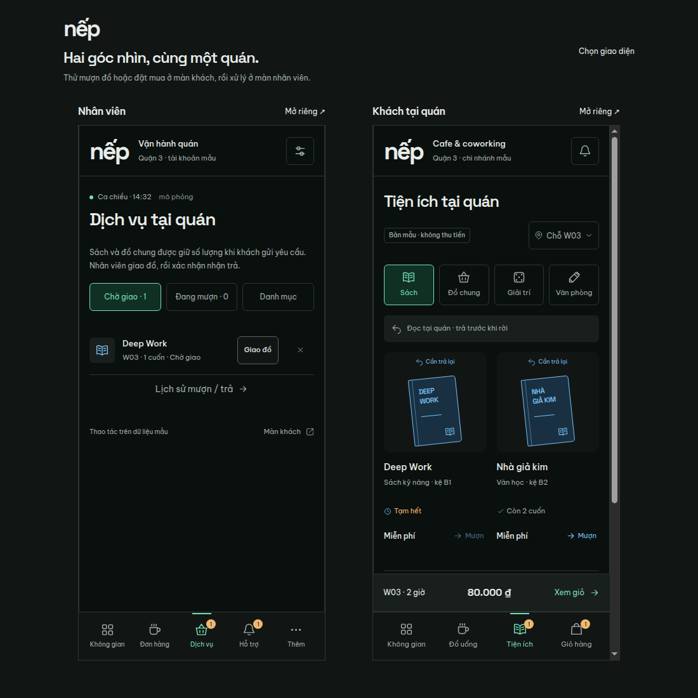
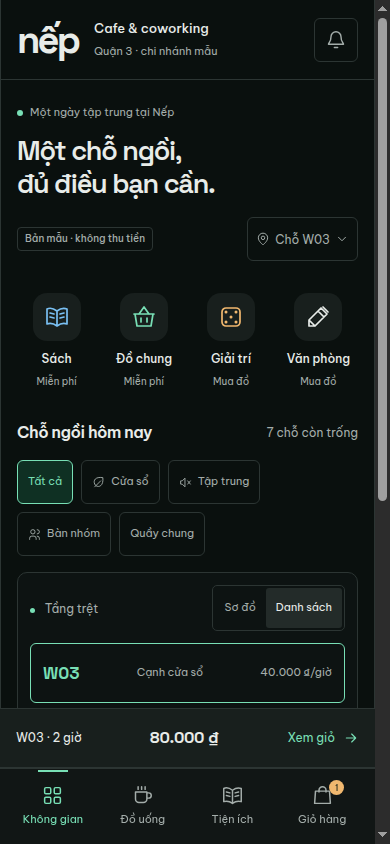
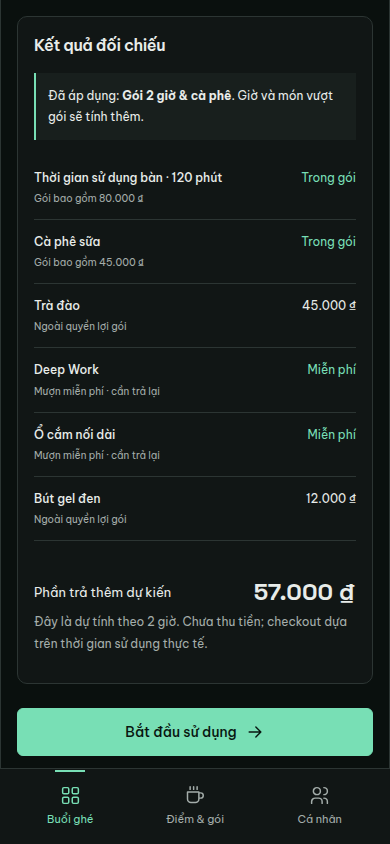
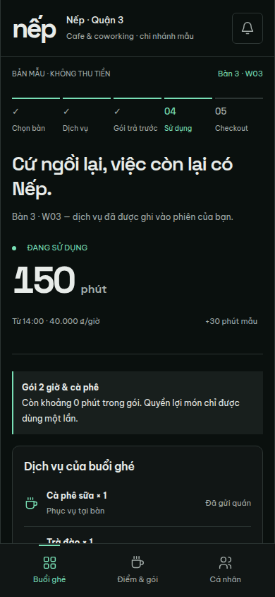
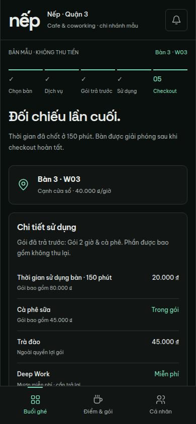
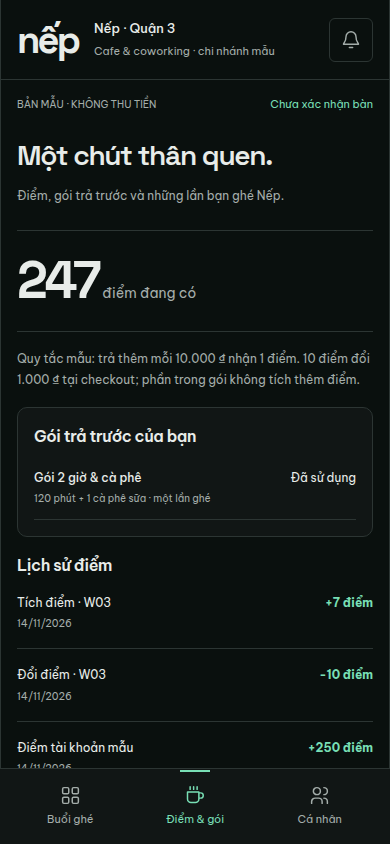
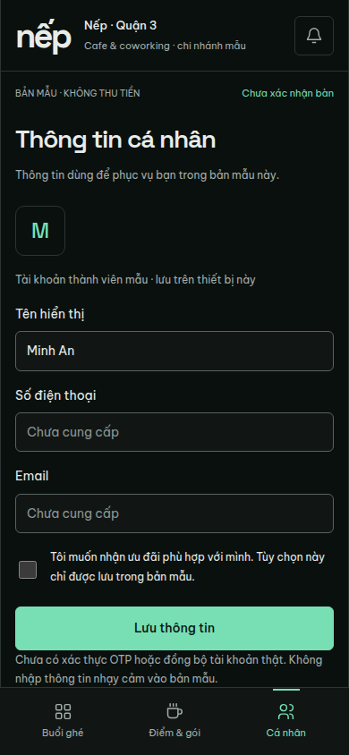

# Kiểm tra hành trình khách trên HTML

Ngày 14/11/2026. Chromium headless, HTTP server tại root repository, dữ liệu trong browser profile riêng. Kết quả này dành cho HTML prototype; không phải nghiệm thu pilot.

## Kết quả

- **37 kiểm thử quy tắc đạt:** 24 cho hành trình và 13 cho dịch vụ. Bao gồm bắt buộc đối chiếu gói, kiểm tra lại bàn/tồn, snapshot giá/quyền lợi, gói hết hạn trong phiên, thêm dịch vụ, trả đồ, lỗi thanh toán, điểm và chống xử lý lặp.
- **72 điểm kiểm tra trình duyệt đạt**, kèm xác nhận nội dung/nút: nhập số, QR đúng/sai quán, bàn bận, chọn sơ đồ bằng bàn phím, thêm/xóa món, gói tài khoản/mã, phiên liên màn, giao/nhận trả, lỗi/thử lại, biên nhận, lưu hồ sơ và lịch sử điểm.
- Sáu bước/trạng thái khách và màn không gian nhân viên vừa viewport **320, 375, 414 và 768 px**. Các nút chính và input không bị cắt ngang. Khung nội dung giữ tối đa 480 px.
- Nhân viên thấy khoản ghi vào phiên chưa checkout; đánh dấu phục vụ không đổi trạng thái thanh toán. Nút kết thúc cũ không giải phóng phiên khách còn mở. Đổi ngày xem chi tiết bàn không gây lỗi JavaScript.
- Các trang thử không có lỗi JavaScript. Kiểm tra tài nguyên xác nhận 39 liên kết HTML tải được, ID không trùng và CSS/font tham chiếu tệp có thật.
- Sau khi cập nhật từ `origin/main`: `npm run check` đạt typecheck, lint và **198 tests**; `npm run format:check` và `npm run build:web` đạt trên Node 22. Các tệp prototype sửa đổi cũng đạt Prettier.

Kịch bản tính tiền xuyên hai màn: 150 phút tại bàn cửa sổ 40.000 ₫/giờ, hai cà phê sữa, một trà và một bút có tổng 247.000 ₫. Gói bù 125.000 ₫, còn 122.000 ₫. Đổi 10 điểm giảm 1.000 ₫, thực trả **121.000 ₫**, nhận 12 điểm; số dư từ 250 thành **252 điểm**. Hai món mượn phải được nhân viên nhận trả trước khi checkout. Thanh toán lỗi giữ nguyên bàn, điểm và chưa tạo biên nhận; thành công chỉ quyết toán một lần.

## Chạy lại

Từ root repository, bật HTTP server ở terminal riêng:

```sh
rtk proxy python3 -m http.server 4173 --bind 127.0.0.1
```

Sau `npm ci` và cài Chromium cho Playwright:

```sh
rtk proxy node --test prototype/services.check.cjs prototype/journey.check.cjs
rtk proxy node prototype/journey.browser.cjs
rtk proxy npm run check
rtk proxy npm run format:check
rtk proxy npm run build:web
```

Browser script dùng `NEP_BASE_URL` nếu cần địa chỉ khác và `PLAYWRIGHT_CHROMIUM_EXECUTABLE` nếu dùng Chromium cài sẵn. Lần kiểm tra này dùng executable Chromium đã có trong môi trường. Script cố định `Date.now()` và tăng thời gian bằng thao tác demo để phép tính có thể lặp lại; không dùng profile trình duyệt của người dùng.

## Ảnh hiện tại



| Xác định bàn                           | Đối chiếu quyền lợi                                          |
| -------------------------------------- | ------------------------------------------------------------ |
|  |  |

| Đang sử dụng                                      | Checkout                                             |
| ------------------------------------------------- | ---------------------------------------------------- |
|  |  |

| Loyalty                                                 | Hồ sơ                                               |
| ------------------------------------------------------- | --------------------------------------------------- |
|  |  |

Các ảnh dùng kịch bản minh họa riêng, không phải ảnh của toàn bộ từng assertion tự động. [Quy tắc và giới hạn hành trình](customer-journey.md). Chưa kiểm tra Safari/iOS thật, camera QR vật lý, backend nhiều thiết bị, xác thực, giao dịch tiền thật hoặc AI.
