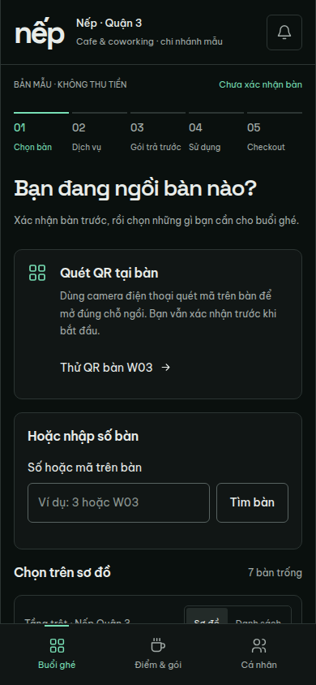
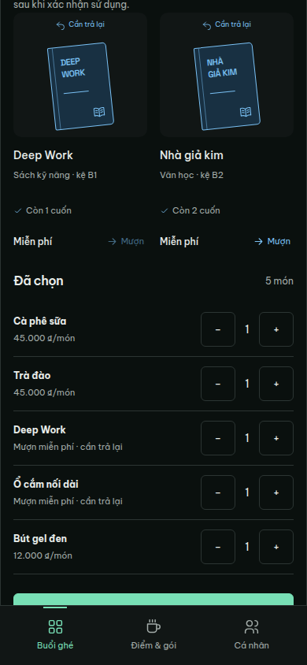
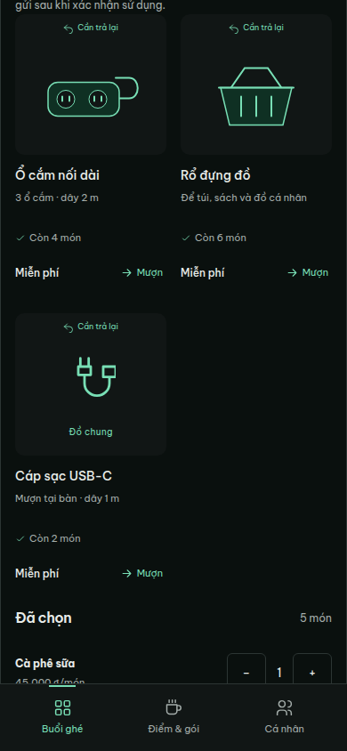
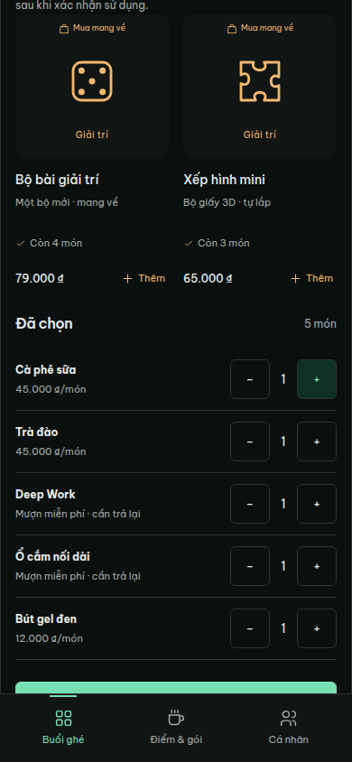
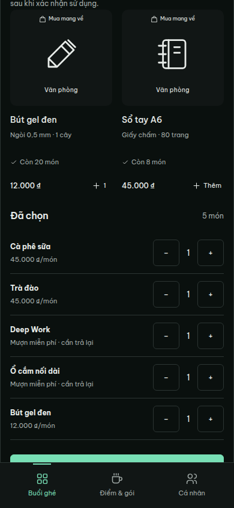
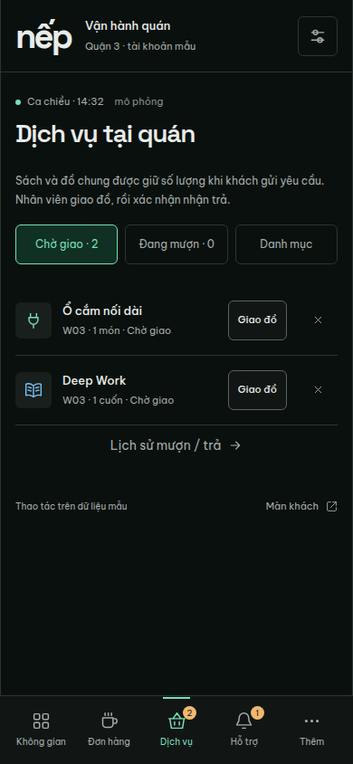

# Kiểm tra prototype HTML trên điện thoại

> **Báo cáo lịch sử:** các kết quả và ảnh dưới đây thuộc luồng giỏ hàng/thanh toán trước, trước lần sửa hành trình khách. Không dùng chúng làm bằng chứng kiểm tra luồng mới: xác định bàn → dịch vụ → đối chiếu gói → sử dụng → checkout. Xem [hành trình hiện tại và kịch bản cần thử](customer-journey.md).

Ngày kiểm tra: 14/11/2026. Môi trường: Chromium headless qua agent-browser; HTML chạy bằng Python HTTP server. Các kiểm tra xác minh prototype cục bộ, chưa là nghiệm thu sản phẩm pilot.

## Kết quả đợt cập nhật

- 13 kiểm thử biên của quy tắc dịch vụ đã đạt: mượn, giữ số lượng, giao, nhận trả, hủy, mua hàng, chống xử lý lặp và thêm dữ liệu dịch vụ vào browser state cũ.
- 175 kiểm tra trình duyệt cho tính năng mới và bố cục đã đạt; thêm 8 kiểm tra hồi quy cho đặt chỗ, đồ uống, check-in, hỗ trợ, editor, duyệt giá và preview liên màn.
- Thêm 4 kiểm tra vùng chạm ở 320, 375, 414 và 480 px: nút giao đồ và hủy yêu cầu nằm riêng, không chồng lên nhau.
- Đã kiểm tra khung nội dung tối đa 480 px và không tràn ngang tại 320, 375, 390, 414, 480, 768 và 1440 px trên các tab khách/nhân viên. Cả bốn danh mục dịch vụ đều vừa khung ở các kích thước này.
- Điều hướng dưới nằm trong viewport, có vùng chạm và nhãn chữ. Biểu mẫu/chi tiết dùng native dialog, đóng bằng nút và Escape.
- Đồng bộ phiếu mượn giữa hai iframe thật trong trang preview đã đạt.
- `npm run check` đạt typecheck, lint và 19 test lõi hiện có; `npm run format:check` và `npm run build:web` đạt trên Node 22. Không thay đổi demo core của ứng dụng Expo.

## Các luồng đã thử

1. Khách mượn cuốn sách cuối cùng: giữ tồn ngay, nút mượn hết lượt bị khóa, không tạo khoản thu.
2. Khách yêu cầu ổ cắm nối dài; nhân viên thấy cả phiếu sách và đồ dùng trong Chờ giao.
3. Nhân viên giao đồ, rồi nhận trả; tồn khả dụng khôi phục đúng một lần. Hủy phiếu chưa giao giải phóng tồn.
4. Phiên đang dùng chỗ chưa thể kết thúc khi còn phiếu mượn cần xử lý.
5. Hai bút và một sổ vào giỏ có tổng mẫu 69.000 ₫. Tắt gói giờ để chỉ mua hàng, chọn chỗ đang sử dụng làm nơi nhận.
6. Thanh toán lỗi không làm giảm tồn; thành công chỉ tạo một đơn, giảm đúng số lượng và không thay đổi booking/phiên hiện tại khi không mua giờ.
7. Tồn thay đổi trước khi xác nhận được kiểm tra lại; không tạo đơn vượt số lượng.
8. Dữ liệu đơn cũ được giữ khi bổ sung các trường dịch vụ; không buộc người dùng xóa localStorage.
9. Luồng cũ gói tập trung 4 giờ và hai cà phê sữa vẫn có tổng mẫu 210.000 ₫; nhân viên check-in và nhận được ghi chú hỗ trợ.
10. Hủy chỉnh bố trí khôi phục tọa độ; duyệt giá trong tab Thêm vẫn hoạt động.

## Rà soát giao diện

Hai màn giữ hệ màu tối/mint, font và icon thống nhất; đổi bố cục sang nội dung dọc và điều hướng dưới. Dịch vụ có nhãn mượn/mua và cần trả lại; màu chỉ là tín hiệu bổ sung. Trang xem song song nhúng hai màn thật bằng iframe, không vẽ thanh hệ điều hành hoặc vỏ điện thoại giả.

Kiểm tra màu đã render trên 174 node chữ HTML của ba trang mặc định không phát hiện chữ dưới ngưỡng: chữ nhỏ 4,5:1, chữ lớn 3:1. Nút mint giữ tỷ lệ chữ khoảng 11,41:1; focus riêng cho nút mint giữ khoảng 3,36:1 so với nút. Kiểm tra này chưa bao gồm toàn bộ SVG, mọi modal, opacity disabled hoặc mọi trạng thái hover; chưa là audit WCAG đầy đủ. Sơ đồ có lựa chọn thay thế bằng danh sách.

## Ảnh preview

### Hai màn điện thoại cùng lúc


### Màn nhân viên và màn khách




### Nhận diện dịch vụ











## Lệnh kiểm tra

```bash
rtk proxy node --test prototype/services.check.cjs
rtk proxy node --check prototype/shared.js
rtk proxy node --check prototype/services.js
rtk proxy node --check prototype/service-ui.js
rtk proxy node --check prototype/operations.js
rtk proxy node --check prototype/customer.js
rtk proxy npm run check
rtk proxy npm run format:check
rtk proxy npm run build:web
rtk git diff --check
```

Các lệnh npm cần Node 22 theo `.nvmrc`. Kịch bản thử bằng tay có trong [hướng dẫn prototype](prototype.md). Chưa kiểm tra Safari/iOS thật, hiệu năng thiết bị thật, giao dịch đồng thời trên nhiều máy, xác minh danh tính, cổng thanh toán, tiền cọc/phạt hoặc AI thật. Chế độ giảm chuyển động và các giới hạn của bản prototype đầu vẫn được giữ.
