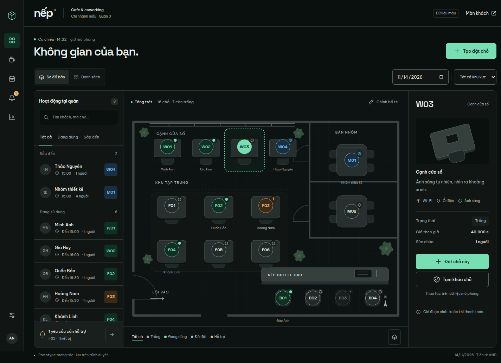

# Kiểm tra prototype HTML

Ngày kiểm tra: 14/11/2026. Môi trường: Chromium headless qua agent-browser, phục vụ file tĩnh bằng Python HTTP server. Kiểm tra này xác minh prototype cục bộ, không phải nghiệm thu sản phẩm pilot.

## Kết quả

- 57 kiểm tra trình duyệt đã đạt, gồm các kịch bản nghiệp vụ bên dưới và kiểm tra hiển thị trên ba trang.
- Kiểm tra bổ sung đồng bộ hai tab cùng origin đã đạt: đổi trạng thái chỗ ở màn vận hành tự cập nhật lựa chọn ở màn khách qua sự kiện storage.
- Ba file JavaScript qua `node --check`; các trang không phát sinh JavaScript runtime exception trong lượt kiểm tra.
- Không có tràn ngang ở 320, 375, 414, 768, 1280 và 1440 px trên trang vào, màn vận hành và màn khách. Các control chữ dùng chế độ một dòng; đã xem ảnh tại bốn kích thước mobile/tablet.
- Đã kiểm tra chế độ reduced motion và đóng dialog bằng Escape.

## Các luồng đã thử

1. Chọn khu tập trung, đổi gói 4 giờ, thêm hai cà phê sữa; tổng tiền 210.000 ₫.
2. Mô phỏng thanh toán lỗi: chưa phát sinh đơn/reservation; sau đó xác nhận thành công đúng một lần.
3. Xác nhận hiển thị số tiền đã mua, đơn/reservation/ghi chú xuất hiện ở màn nhân viên.
4. Nhân viên check-in, đánh dấu đã phục vụ, nhận việc và hoàn tất hỗ trợ.
5. Quản lý duyệt ưu đãi mẫu; gói tập trung 2 giờ mới có tổng tiền chỗ 54.000 ₫.
6. Di chuyển vị trí chỗ bằng editor và hủy để khôi phục tọa độ gốc.
7. Tạo/hủy đặt chỗ ngày mai; không thay đổi phiên sử dụng hiện tại của cùng chỗ.
8. Nội dung hỗ trợ có chuỗi HTML được hiển thị như văn bản, không tạo thẻ ảnh hoặc chạy nội dung chèn.
9. Chuyển đổi responsive, danh sách/sơ đồ, điều khiển giảm chuyển động và đồng bộ dữ liệu giữa tab.

## Rà soát giao diện theo Hallmark

Hai màn có cấu trúc khác nhau nhưng dùng chung hệ màu và typography. Ảnh tham chiếu được dùng để định hướng sơ đồ và phân bố thông tin; không dùng ảnh chụp làm lớp nền giả giao diện. Không có browser/phone frame giả, gradient trang trí, emoji thay icon hoặc số liệu hiệu quả kinh doanh tự tạo.

Kiểm tra tương phản bằng màu đã render trên 186 node chữ HTML của ba trang mặc định không phát hiện trường hợp dưới ngưỡng: chữ nhỏ 4,5:1, chữ lớn 3:1. Chữ tối trên nút mint đạt khoảng 11,41:1. Vòng focus riêng cho nút mint đạt khoảng 3,36:1 so với nút và 3,54:1 so với nền chính. Kiểm tra này không bao gồm toàn bộ SVG, opacity của trạng thái disabled, mọi modal hoặc mọi trạng thái hover; chưa là audit WCAG đầy đủ.

## Ảnh preview

### FE1 vận hành



### FE2 khách


## Lệnh kiểm tra tĩnh

```bash
rtk proxy node --check prototype/shared.js
rtk proxy node --check prototype/operations.js
rtk proxy node --check prototype/customer.js
rtk git diff --check
```

Các kiểm tra browser đã chạy qua phiên agent-browser của môi trường làm việc. Kịch bản thử bằng tay có trong [hướng dẫn prototype](prototype.md). Chưa kiểm tra Safari/iOS thật, độ tải hệ thống, giao dịch đồng thời, đăng nhập/phân quyền, cổng thanh toán hoặc mô hình AI.
