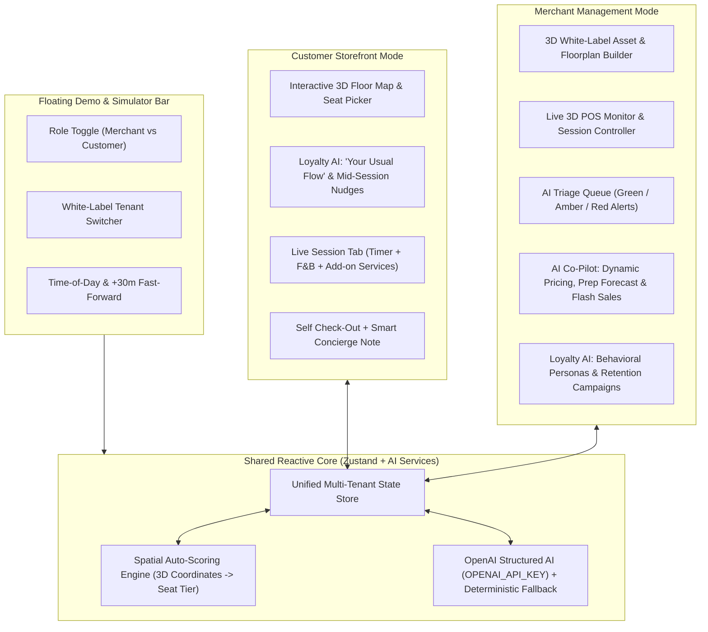
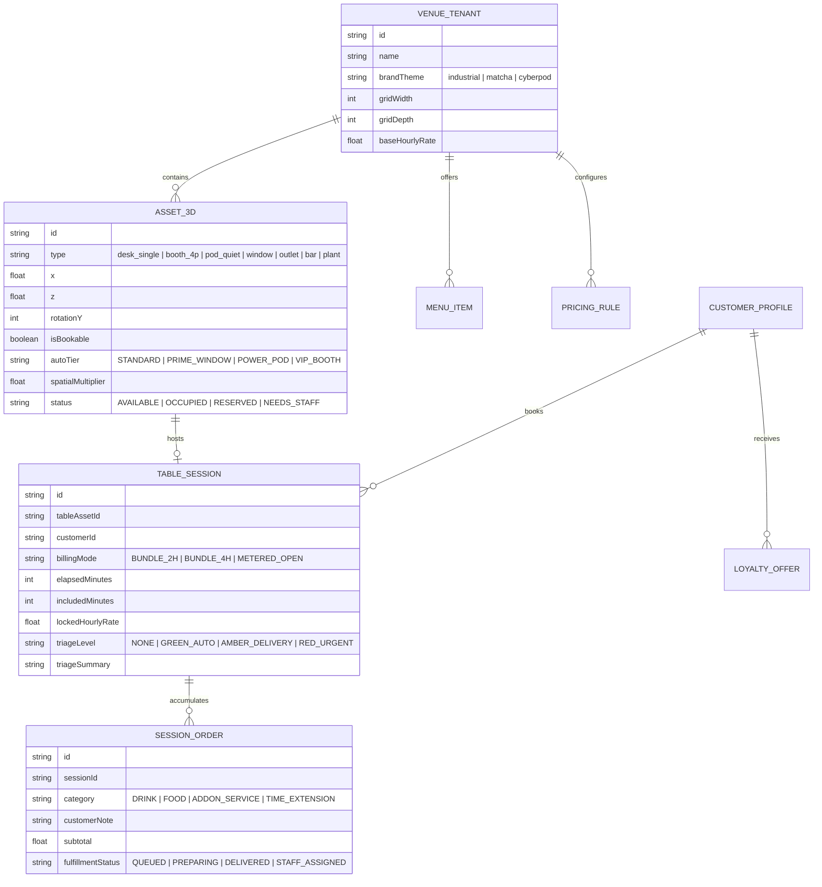
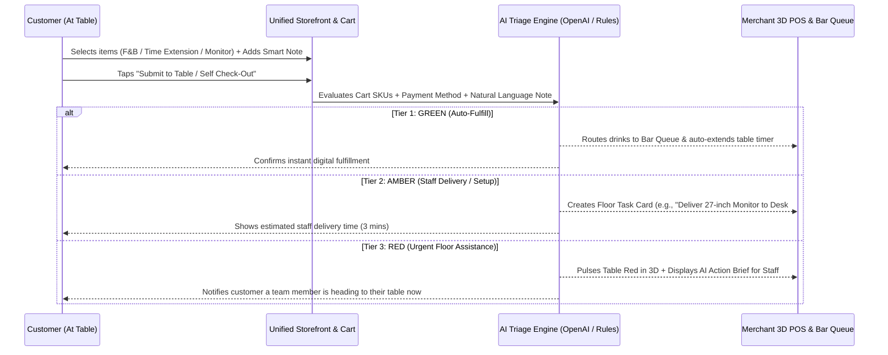

# 3D Cafe & Co-Working Space Platform — React Native Architecture & Implementation Plan

A unified, white-label **React Native (Expo)** platform combining a **Merchant 3D Space & POS Management App** and a **Customer 3D Storefront & Self-Checkout App** within a single application featuring instant role switching and a live time/traffic simulator.

> [!IMPORTANT]
> **Core Architectural Decisions Agreed Upon**
> - **App Packaging**: Single unified React Native (Expo Router) application with instant switching between **Merchant Mode** (Owner/Staff) and **Customer Mode** (Storefront), plus a floating **Simulation Control Bar** (`Role`, `White-Label Brand`, `Time-of-Day Scenario`, `+30m Session Fast-Forward`).
> - **3D Engine**: Interactive Grid-Based 3D Builder and Viewer powered by `Three.js` + `@react-three/fiber` (`@react-three/drei`) with modular 3D primitives/GLTF assets, real-time table status lighting, and white-label material/lighting themes.
> - **POS & Billing**: Unified **Live Session Tab** combining Fixed Time Bundles, Pay-As-You-Go Metered Seat Time, F&B orders, and Add-On Services (monitors, chargers, printing, meeting gear).
> - **AI Architecture**: OpenAI Structured-Output AI Engine (`OPENAI_API_KEY` via `gpt-4o-mini` / `gpt-4o` JSON Schema response format) paired with an instant deterministic local heuristic engine (zero-latency fallback) over a shared **Zustand** reactive store.

---

## 1. System Architecture Overview



---

## 2. Tech Stack & Project Structure

### Technology Stack
| Layer | Technology | Purpose |
| :--- | :--- | :--- |
| **Framework** | Expo SDK 52+ (React Native + Expo Router) | Universal navigation, fast iteration, iOS / Android / Web support |
| **3D Graphics** | `three`, `@react-three/fiber`, `@react-three/drei`, `expo-gl` | Interactive 3D room rendering, camera orbit/pan, raycast table selection, grid snapping |
| **State Management** | `zustand` + `AsyncStorage` persistence | Zero-latency reactive sync between Merchant Mode, Customer Mode, and 3D scene |
| **Styling & UI** | `NativeWind` (Tailwind CSS v3/v4) + `react-native-reanimated` | Dynamic white-label theming, smooth bottom sheets, pulsing alert animations |
| **Icons & Charts** | `lucide-react-native` + lightweight SVG charts | POS controls, occupancy heatmaps, kitchen demand timelines |
| **AI Layer** | `openai` SDK (`OPENAI_API_KEY` Structured JSON Outputs) + Local Heuristic Engine | 3-Tier Triage classification, Dynamic Pricing co-pilot, Prep forecasting, Loyalty AI |

### Proposed Directory Structure
```text
vibing-hkt/
├── .env.example                    # OPENAI_API_KEY / EXPO_PUBLIC_OPENAI_API_KEY configuration
├── app/
│   ├── _layout.tsx                 # Root provider + Floating Simulator & Role Switcher Bar
│   ├── index.tsx                   # Entry router (redirects/renders active Role View)
│   ├── (merchant)/                 # Merchant App Screens
│   │   ├── _layout.tsx             # Merchant Tab/Split Navigation
│   │   ├── live-floor.tsx          # 3D Live POS Floor Monitor + AI Triage Queue + Active Tabs
│   │   ├── builder-3d.tsx          # White-Label 3D Asset & Spatial Floorplan Editor
│   │   ├── ai-pricing.tsx          # Dynamic Pricing Co-Pilot, Kitchen Forecast & Flash Sales
│   │   └── loyalty-crm.tsx         # Behavioral Personas & AI Retention Campaigns
│   └── (customer)/                 # Customer Storefront Screens
│       ├── _layout.tsx             # Customer Tab Navigation
│       ├── explore-3d.tsx          # 3D Seat Discovery, Flash Sale Banners & Booking
│       ├── active-session.tsx      # Live Table Timer, Menu Ordering, Smart Note & Self-Checkout
│       └── loyalty-perks.tsx       # "Your Usual Flow" Bundles & Personal Usage Insights
├── src/
│   ├── components/
│   │   ├── canvas3d/               # R3F 3D Components
│   │   │   ├── VenueScene3D.tsx    # Main 3D Canvas, lighting, floor grid, camera controller
│   │   │   ├── AssetMesh3D.tsx     # Modular 3D meshes (Desks, Booths, Outlets, Windows, Plants, Bar)
│   │   │   ├── TableStatusBadge.tsx# Floating 3D HTML/Billboard status & timer overlay
│   │   │   └── SpatialHeatOverlay.tsx # Visualizes seat tier scores & outlet/window radii
│   │   ├── simulator/
│   │   │   └── GodModeBar.tsx      # Floating Switcher (Merchant/Customer, Tenant, Time, +30m)
│   │   ├── merchant/               # POS drawers, Triage cards, Pricing approval cards
│   │   └── customer/               # Booking sheet, Cart & Smart Note modal, Mid-session nudge
│   ├── services/
│   │   ├── ai/
│   │   │   ├── openaiClient.ts     # OpenAI Structured JSON wrapper (OPENAI_API_KEY) with fallback
│   │   │   ├── triageEngine.ts     # Self-checkout request classifier (Green / Amber / Red)
│   │   │   ├── pricingEngine.ts    # Spatial scoring + Surge/Flash Sale + Prep load calculator
│   │   │   └── loyaltyEngine.ts    # Habit detection, "Usual Flow" builder & persona clustering
│   │   └── pos/
│   │       └── billingCalculator.ts# Hybrid time-bundle + metered overtime + F&B + add-on math
│   ├── store/
│   │   ├── useAppStore.ts          # Global Zustand store (Venues, Sessions, Orders, AI Proposals)
│   │   └── seedVenues.ts           # 3 Pre-built White-Label Venues with rich demo histories
│   └── types/
│       └── domain.ts               # Core TypeScript interfaces
```

---

## 3. Data Model & Domain Schema



---

## 4. Detailed Feature Specifications

### 4.1 White-Label 3D Asset & Spatial Builder (`builder-3d.tsx`)
1. **Pre-Loaded White-Label Tenants**:
   - **The Grind Co-Work**: Warm industrial wood/concrete palette, communal worktables, private focus pods, specialty espresso bar.
   - **Matcha & Muse Studio**: Soft sage/cream aesthetic, window lounge seating, creative sketching tables, artisanal tea bar.
   - **CyberPod 24/7 Hub**: Dark slate & neon cyan lighting, soundproof solo coding pods, dual-monitor rental stations, energy drink bar.
2. **Interactive Grid Editor**:
   - **Asset Catalog Drawer**: Placeable 3D objects divided into *Bookable Seats* (Solo Desk, 2P Window Table, 4P Collaboration Booth, Soundproof Focus Pod), *Infrastructure* (Floor-to-Ceiling Window, Wall Power Outlet, Quiet Zone Divider, Bar Counter), and *Decor* (Monstera Plants, Bookshelves, Pendant Lamps).
   - **Snap-to-Grid Manipulation**: Tap a grid tile to place, tap an existing asset to select, drag or use directional nudge controls, rotate in `90°` increments, or delete.
   - **Automatic Spatial Scoring (`SpatialCalc`)**: Every time a seat or infrastructure asset is moved in the 3D editor, the engine recalculates Euclidean distances on the `(x, z)` grid:
     - Proximity `< 2.5` units to a `Window` asset adds `+15%` Natural Light value.
     - Proximity `< 2.0` units to a `Power Outlet` asset adds `+15%` Power Access value.
     - Inside a `Quiet Zone` or far (`> 4.0` units) from the `Bar Counter` adds `+10%` Focus Score.
     - Automatically assigns the seat tier (`STANDARD`, `PRIME_WINDOW`, `POWER_POD`, `VIP_BOOTH`) and base multiplier (`1.0x` to `1.45x`).

> [!TIP]
> **Live 3D Lighting Feedback**: In both Merchant Live Monitor and Customer Storefront, each bookable 3D desk/booth renders a subtle glowing base ring and floating badge:
> - **Emerald (`#10B981`)**: Available (shows current dynamic hourly price)
> - **Sky Blue (`#0EA5E9`)**: Occupied — Normal active session (shows live timer)
> - **Amber (`#F59E0B`)**: Reserved / Staff Delivery En Route
> - **Pulsing Crimson (`#EF4444`)**: Red AI Triage Alert — Staff Assistance Needed at Table

---

### 4.2 Hybrid POS Engine & Live Session Tab (`billingCalculator.ts`)
Supports three revenue streams inside one unified **Table Session Tab**:
1. **Seat Time Billing**:
   - **Fixed Bundles**: e.g., *2-Hour Deep Work Pass* (includes 1 signature drink at 15% bundle discount) or *4-Hour Half-Day Pass*.
   - **Pay-As-You-Go Metered**: Billed in 15-minute increments using the dynamic rate locked in at check-in.
   - **Overtime Handling**: If a Fixed Bundle exceeds its included minutes, the session seamlessly transitions into metered overtime with a 10-minute grace period.
2. **F&B Ordering**:
   - Specialty coffee, tea, brain-food snacks, pastries — customizable modifiers (milk type, sweetness, ice level).
3. **Add-On Co-Working Services**:
   - Hardware & Amenities billed per session or per unit: *27" 4K USB-C Monitor Rental*, *65W GaN Fast Charger*, *Color Printing (per page)*, *Podcast Mic Kit*, *Whiteboard Marker Set*.

---

### 4.3 Self Check-Out & 3-Tier AI Staff Triage (`triageEngine.ts`)



- **How the AI Classifies Requests**:
  - Uses `OPENAI_API_KEY` (`gpt-4o-mini` / `gpt-4o` with Structured JSON Outputs) with an automatic local heuristic fallback if offline or no key is set.
  - Evaluates both structured cart contents and the customer's free-text **Smart Concierge Note** (e.g., *"I spilled water near the power strip"*, *"Can I split payment half cash and half card?"*, *"Severe peanut allergy, please sanitize blender"*, or *"HDMI cable on monitor isn't working"*).
  - Outputs a structured JSON payload:
    - `triageLevel`: `'GREEN_AUTO' | 'AMBER_DELIVERY' | 'RED_URGENT'`
    - `requiresHumanStaff`: `boolean`
    - `department`: `'BAR_KITCHEN' | 'FLOOR_TECH' | 'CASHIER_HOST'`
    - `staffBrief`: Concise 1-line instruction for the staff member (e.g., `"Bring 65W USB-C charger + assist with split cash payment at Window Desk #2"`).
    - `estimatedResolutionMinutes`: `number`

---

### 4.4 AI Dynamic Pricing, Kitchen Prep Forecasting & Flash Sales (`ai-pricing.tsx`)
1. **Real-Time Surge & Off-Peak Pricing**:
   - Combines **Live Venue Occupancy %**, **Seat Tier Demand**, and **Time-of-Day Curve**:
     - *Peak Rush (>75% occupancy)*: Suggests `+20%` to `+35%` surge on `PRIME_WINDOW` and `VIP_BOOTH` seats while keeping `STANDARD` seats accessible (`1.0x`) to maximize fill rate.
     - *Mid-Afternoon Slump (<35% occupancy)*: Suggests off-peak incentives or Flash Sales.
2. **Predictive Service & F&B Prep Alerts**:
   - Analyzes active session check-in cohorts and historical ordering curves:
     - e.g., *"9 Morning Deep-Work sessions checked in between 8:30–9:00 AM. Based on 2-hour dwell patterns, expect a second-caffeine + pastry order wave at 10:45 AM (+65% Cold Brew & Croissant demand). Pre-batch 12 Cold Brew portions now."*
3. **1-Tap Flash Sale Generator**:
   - Identifies underutilized seat tiers or perishable inventory windows and generates a ready-to-launch campaign card:
     - e.g., *"4 Collaboration Booths empty during 2:00–5:00 PM slump -> Launch 'Afternoon Team Sprint: 40% off 4P Booths + Free Pitcher of Craft Iced Tea'"*.
   - When the Merchant taps **"Approve & Broadcast"**, an interactive **Live Flash Sale Banner** immediately appears in the Customer Storefront Mode and highlights those specific booths in gold inside the Customer 3D view.

---

### 4.5 Dual-Sided Loyalty AI (`loyaltyEngine.ts`)
1. **Customer-Facing Experience (`explore-3d.tsx` & `active-session.tsx`)**:
   - **"Your Usual Flow" 1-Tap Card**: Spots recurring usage trends from the customer's session history (e.g., *"Alex: Checked in 8 times on weekday mornings, 88% of sessions at Window Desk with Power, average 2.5 hours + Iced Oat Matcha"*). Offers a 1-tap booking card that pre-selects the nearest available matching 3D seat, locks in a personalized loyalty bundle discount (`15% off`), and queues their signature drink.
   - **Contextual In-Session Nudge**: When the user fast-forwards the session timer past `120 minutes` using the Simulator Bar, Loyalty AI triggers an in-app smart toast: *"2 hours of deep focus completed! Extend +1 hour at 30% off & add your favorite Almond Croissant for $2.50."*
2. **Merchant-Facing CRM Experience (`loyalty-crm.tsx`)**:
   - Clusters customers into actionable **AI Behavioral Personas**:
     - **Deep-Work Morning Regulars** (High seat consistency, solo desks, high coffee attach rate)
     - **Afternoon Study & Sprint Pods** (Group booths, high snack/printing attach rate, price-sensitive)
     - **Power-User Remote Engineers** (Long 4h+ sessions, heavy monitor/charger rental usage)
   - Provides 1-tap **"Generate Retention Offer"** per persona segment.

---

### 4.6 Floating Simulator & Role Switcher Bar (`GodModeBar.tsx`)
To make testing and live demos effortless within the single unified app, a sleek collapsible floating bar sits at the top/bottom edge of the screen:
- **Role Toggle**: Instant switch between `Merchant View` and `Customer View` (preserving the currently selected table/session context).
- **White-Label Tenant Selector**: Instant switch between `The Grind`, `Matcha Studio`, and `CyberPod 24/7` (updates UI theme colors, 3D room materials/lighting, floor layout, and POS menu).
- **Scenario Preset Buttons**:
  - `Morning Rush (85% Full)` — triggers peak dynamic pricing & kitchen prep alerts.
  - `Afternoon Slump (25% Full)` — triggers AI Flash Sale proposals for empty booths.
- **`+30m` Session Fast-Forward Button**: Advances all active table timers by 30 minutes to demonstrate live metered billing ticks, overtime transitions, and the 2-hour Loyalty AI mid-session upsell nudge.

---

## 5. Phased Implementation Roadmap

### Phase 1: Foundation, Unified Store & White-Label Theme Engine
1. Initialize Expo Router project with TypeScript, NativeWind, and `.env` support for `OPENAI_API_KEY`.
2. Define core domain models (`src/types/domain.ts`) and seed 3 complete White-Label Venues with realistic 3D floorplans, menus, active sessions, and customer histories (`src/store/seedVenues.ts`).
3. Build `useAppStore.ts` (Zustand) and the floating `GodModeBar.tsx` for role switching, venue switching, time-of-day simulation, and `+30m` session fast-forwarding.

### Phase 2: Interactive 3D Spatial Engine & White-Label Builder
1. Build `VenueScene3D.tsx` and modular low-poly 3D asset meshes (`AssetMesh3D.tsx`) for desks, group booths, focus pods, windows, power outlets, bar counters, and plants.
2. Implement real-time status lighting (Available, Occupied, Reserved, Red Triage Alert) and raycast tap selection.
3. Build the Merchant **3D Spatial Builder** (`builder-3d.tsx`) with grid snapping, rotation, asset placement, and the live **Spatial Auto-Scoring Engine** (`SpatialCalc`) that updates seat tiers as objects move.

### Phase 3: Hybrid POS Engine, Self Check-Out & AI Staff Triage
1. Build Customer 3D seat discovery, booking sheet (Fixed Bundle vs. Metered Open Tab), and active session timer dashboard.
2. Implement the Hybrid Cart (F&B + Add-on Services + Time Extension) and **Smart Concierge Note** input.
3. Build `triageEngine.ts` (OpenAI `OPENAI_API_KEY` structured JSON + local deterministic classifier) and wire it to the Merchant 3D floor monitor so Red/Amber requests highlight the 3D table and pop up actionable staff triage cards.

### Phase 4: AI Dynamic Pricing, Prep Forecasting, Flash Sales & Loyalty AI
1. Build the Merchant **AI Co-Pilot Dashboard** (`ai-pricing.tsx`) with live seat-tier surge calculators, F&B kitchen prep wave timelines, and 1-tap Flash Sale broadcast cards powered by `openaiClient.ts`.
2. Wire approved Flash Sales to appear live in the Customer Storefront 3D view.
3. Build the **Dual-Sided Loyalty AI** (`loyaltyEngine.ts`): Customer *"Your Usual Flow"* 1-tap booking card, `+120m` mid-session upsell modal, and Merchant Behavioral Persona CRM screen.
