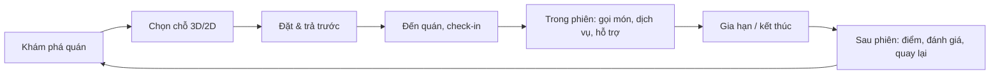

# Brainstorm tính năng cho khách hàng (User)

Phiên bản 0.1 — 14/11/2026 — Tài liệu brainstorm, chưa phải phạm vi đã chốt.

Nguồn: [PRD MVP](../.beads/artifacts/vhk-qwb/prd.md) và [kế hoạch React Native 3D](react-native-plan.md). Tài liệu này mở rộng góc nhìn **khách hàng** (người đến quán ngồi làm việc, học, gặp gỡ) thành danh sách tính năng để đội chọn dần. Phần nền (base: tenant, POS, booking, payment, 3D viewer) sẽ được xây theo PRD; các tính năng ở đây được thiết kế để cắm lên base đó.

## 0. Cách đọc

| Nhãn ưu tiên | Ý nghĩa |
| --- | --- |
| **P0 — Pilot** | Đã có trong PRD hoặc là phần trải nghiệm tối thiểu để khách dùng được luồng pilot |
| **P1 — Sau luồng cốt lõi** | Làm khi đặt chỗ + thanh toán ổn định; chi phí thấp, tăng trải nghiệm rõ |
| **P2 — Sau MVP** | Cần thêm dữ liệu, tích hợp hoặc nguồn lực; để cho vòng tiếp theo |
| **P3 — Ý tưởng xa** | Thử nghiệm/khác biệt hóa; chỉ làm khi có tín hiệu thị trường |

Mỗi tính năng ghi `Liên quan` tới FR trong PRD để biết phụ thuộc vào module nào. Mọi tính năng phải tuân thủ nguyên tắc của PRD: server quyết định giá/lịch/tiền, AI chỉ đề xuất, không cộng dồn ưu đãi, không lộ dữ liệu khách khác, 3D luôn có phương án danh sách/2D.

## 1. Hành trình khách hàng

Tính năng được nhóm theo từng chặng của hành trình.

## 2. Khám phá & lựa chọn quán

| ID | Tính năng | Mô tả | Ưu tiên | Liên quan |
| --- | --- | --- | --- | --- |
| U-D01 | Trang quán theo thương hiệu | Logo, màu, giờ mở cửa, địa chỉ, menu, bảng giá giờ ngồi theo hạng chỗ | P0 | FR01, FR06 |
| U-D02 | Xem nhanh công suất hiện tại | "Còn 12/40 chỗ", hạng chỗ còn trống; chỉ số tổng hợp, không lộ ai đang ngồi | P1 | FR03, FR08 |
| U-D03 | Biểu đồ giờ đông/vắng | Dự báo theo khung giờ trong ngày dựa trên lịch sử booking để khách chọn giờ vắng | P2 | FR06 |
| U-D04 | Bộ lọc tiện ích | Lọc chỗ có ổ cắm, gần cửa sổ, yên tĩnh, bàn nhóm, có màn hình thuê | P1 | FR03 |
| U-D05 | Tour 3D trước khi đến | Xoay/zoom xem không gian quán, ánh sáng theo theme thương hiệu | P1 | FR03 |
| U-D06 | Nhiều chi nhánh cùng thương hiệu | Chọn chi nhánh gần nhất, so sánh chỗ trống giữa chi nhánh | P2 | FR01 |
| U-D07 | Chia sẻ link quán/chỗ ngồi | Gửi link "ngồi bàn cửa sổ số 4 lúc 14:00" cho bạn bè (không kèm thông tin cá nhân) | P1 | FR03 |
| U-D08 | Ghi chú "vibe" của khu vực | Nhãn mô tả: khu im lặng, khu thảo luận, khu gọi điện | P1 | FR03 |

## 3. Chọn chỗ & đặt trước

| ID | Tính năng | Mô tả | Ưu tiên | Liên quan |
| --- | --- | --- | --- | --- |
| U-B01 | Chọn Seat trên sơ đồ 3D | Chạm vào chỗ, xem hạng, giá, tiện ích; màu + icon trạng thái (không chỉ dựa vào màu) | P0 | FR03 |
| U-B02 | Chế độ danh sách/2D | Đầy đủ nghiệp vụ như 3D cho máy yếu/không WebGL | P0 | FR03 |
| U-B03 | Đặt trước theo khung 15 phút, thời lượng bước 30 phút | Hold 5 phút với đồng hồ đếm ngược rõ ràng | P0 | FR04 |
| U-B04 | Gợi ý chỗ thay thế khi trùng | Khi `SEAT_UNAVAILABLE`, đề xuất chỗ cùng hạng/giờ gần nhất | P0 | FR04 |
| U-B05 | Bảng giá chi tiết trước khi trả | Tách đoạn giá theo khung giờ, ưu đãi, phí; hiển thị hạn báo giá | P0 | FR06 |
| U-B06 | "Chỗ quen của tôi" | Ghim chỗ yêu thích; đặt lại 1 chạm nếu còn trống, nếu không gợi ý chỗ tương tự | P1 | FR04, FR07 |
| U-B07 | Đặt lặp lại theo lịch | "Mỗi thứ 2-4-6, 8:00–11:00" — tạo nhiều booking, mỗi lượt vẫn kiểm tra lịch & thanh toán riêng | P2 | FR04 |
| U-B08 | Danh sách chờ (waitlist) | Khi hết chỗ hạng mong muốn, nhận thông báo khi có chỗ trống | P2 | FR04 |
| U-B09 | Đặt cho nhóm | Chọn nhiều Seat liền nhau/booth trong một lần đặt (PRD để thủ công ở pilot) | P2 | FR04 |
| U-B10 | Thêm vào lịch cá nhân | Xuất file `.ics` cho booking đã xác nhận | P1 | FR04 |
| U-B11 | Đặt kèm đồ uống sẵn | Chọn món phục vụ ngay khi check-in (pre-order) | P1 | FR02, FR04 |
| U-B12 | So sánh 2 chỗ | Đặt cạnh nhau: giá, khoảng cách cửa sổ/ổ cắm/quầy bar | P3 | FR03 |

## 4. Đến quán & check-in

| ID | Tính năng | Mô tả | Ưu tiên | Liên quan |
| --- | --- | --- | --- | --- |
| U-C01 | Check-in bằng QR tại bàn + mã booking | QR chỉ định vị; quyền sở hữu qua token/booking code | P0 | FR04, FR05 |
| U-C02 | Nhắc lịch trước giờ đến | Thông báo trong app/web push trước 30 phút, kèm chỉ đường tới chỗ trong 3D | P1 | FR04 |
| U-C03 | "Đang đến muộn" | Khách báo trễ để nhân viên biết; không tự kéo dài cửa sổ check-in | P1 | FR04 |
| U-C04 | Chỉ đường trong quán | Highlight đường đi từ cửa tới Seat trên sơ đồ 3D/2D | P2 | FR03 |
| U-C05 | Walk-in nhanh | Quét QR bàn trống → mua giờ ngay, không cần tài khoản | P0 | FR04, FR05 |
| U-C06 | Thông tin wifi & nội quy | Hiển thị sau check-in: mật khẩu wifi, giờ yên lặng, khu gọi điện | P1 | FR05 |

## 5. Trong phiên sử dụng

| ID | Tính năng | Mô tả | Ưu tiên | Liên quan |
| --- | --- | --- | --- | --- |
| U-S01 | Bảng điều khiển phiên | Đồng hồ còn lại, chỗ ngồi, đơn đã gọi, tổng chi trong phiên | P0 | FR04 |
| U-S02 | Gọi món tại bàn | Menu, size, tùy chọn (đường, đá, sữa), trạng thái hết món | P0 | FR02, FR05 |
| U-S03 | Theo dõi đơn | queued → preparing → ready → served, ước tính thời gian | P0 | FR02 |
| U-S04 | Thuê thiết bị/dịch vụ | Màn hình, sạc, in ấn, phòng họp nhỏ — nhân viên xác nhận khả dụng | P0 | FR02 |
| U-S05 | Gọi nhân viên | Nút luôn tạo yêu cầu, không qua AI | P0 | FR05 |
| U-S06 | Ghi chú thông minh | Viết tự do ("đổ nước gần ổ điện", "dị ứng đậu phộng") → quy tắc + AI phân loại, tình huống nhạy cảm bắt buộc chuyển người | P0 | FR05 |
| U-S07 | Nhắc sắp hết giờ | Trước 15 phút: gợi ý gia hạn nếu lịch còn trống, hoặc gợi ý chỗ khác | P0 | FR04 |
| U-S08 | Gia hạn 1 chạm | Báo giá phần giờ mới, trả xong mới cập nhật giờ kết thúc | P0 | FR04, FR06 |
| U-S09 | Gọi lại món quen | "Như lần trước" — đặt lại món gần nhất | P1 | FR02, FR07 |
| U-S10 | Chế độ tập trung (Focus timer) | Pomodoro gắn với phiên, nhắc nghỉ giải lao + gợi ý đồ uống (khách tự bật) | P2 | FR04 |
| U-S11 | Gợi ý giữa phiên | Sau 2 giờ: ưu đãi gia hạn/đồ ăn nhẹ từ mẫu đã quản lý duyệt | P1 | FR06, FR07 |
| U-S12 | Báo sự cố chỗ ngồi | Ổ cắm hỏng, wifi yếu, bàn bẩn — gắn với Seat để quán xử lý | P1 | FR05 |
| U-S13 | Đổi chỗ có hỗ trợ | Khách yêu cầu, nhân viên thực hiện (PRD: chỉ nhân viên chuyển chỗ) | P1 | FR04 |
| U-S14 | Mức ồn/ánh sáng khu vực | Khách bình chọn nhanh "ồn quá" để quán điều phối; hiển thị tổng hợp | P3 | FR05 |
| U-S15 | Tạm rời chỗ | Đánh dấu "ra ngoài 15 phút" để nhân viên không dọn bàn | P2 | FR04 |

## 6. Thanh toán & kết thúc

| ID | Tính năng | Mô tả | Ưu tiên | Liên quan |
| --- | --- | --- | --- | --- |
| U-P01 | Tự thanh toán online | Server xác minh với cổng thanh toán; trạng thái pending/failed/succeeded rõ ràng | P0 | FR02, FR05 |
| U-P02 | Trạng thái "đang xác minh" | Không khuyến khích trả lại bằng đơn mới; nút kiểm tra lại | P0 | FR05 |
| U-P03 | Trả tiền mặt tại quầy | Khách chọn tiền mặt, thu ngân xác nhận | P0 | FR02 |
| U-P04 | Kết thúc phiên sớm | Khách bấm kết thúc; không tự hoàn phần chưa dùng | P0 | FR04 |
| U-P05 | Biên nhận điện tử | Xem/tải biên nhận trong app, gửi email nếu khách cung cấp | P1 | FR02 |
| U-P06 | Lịch sử chi tiêu | Tổng giờ ngồi, chi tiêu theo tháng (cho thành viên) | P1 | FR07 |
| U-P07 | Yêu cầu hủy/hoàn | Gửi đề nghị; quản lý xử lý theo chính sách | P0 | FR08 |
| U-P08 | Ví trả trước / gói giờ | Mua gói 10h/20h dùng dần (cần quyết định kế toán) | P2 | FR02 |
| U-P09 | Chia bill | Chia đơn cho nhóm (PRD xếp sau MVP) | P2 | FR02 |
| U-P10 | Hóa đơn VAT cho công ty | Nhập thông tin xuất hóa đơn; chờ tích hợp hóa đơn điện tử | P2 | FR02 |

## 7. Thành viên, loyalty & cá nhân hóa

| ID | Tính năng | Mô tả | Ưu tiên | Liên quan |
| --- | --- | --- | --- | --- |
| U-L01 | Đăng ký thành viên bằng OTP | Đồng ý tham gia rõ ràng; guest vẫn mua được | P0 | FR07 |
| U-L02 | Ví điểm & lịch sử | Điểm dự kiến/khả dụng, giữ/trừ/đảo khi hoàn | P0 | FR07 |
| U-L03 | Đổi ưu đãi | Theo quy tắc tenant, không cộng dồn với flash sale | P0 | FR07 |
| U-L04 | "Flow quen thuộc của bạn" | Thẻ 1 chạm: chỗ hay ngồi + thời lượng + món quen (cần ≥3 đơn hoàn tất) | P1 | FR07 |
| U-L05 | Hạng thành viên | Đồng/Bạc/Vàng theo giờ ngồi; quyền lợi như ưu tiên waitlist | P2 | FR07 |
| U-L06 | Thống kê cá nhân | "Tháng này bạn tập trung 32 giờ", khung giờ hay đến, món yêu thích | P1 | FR07 |
| U-L07 | Huy hiệu & chuỗi ngày | Badge "5 buổi sáng liên tiếp", "Night owl" — không đổi ra tiền | P2 | FR07 |
| U-L08 | Giới thiệu bạn bè | Mã giới thiệu, thưởng điểm khi bạn hoàn tất đơn đầu | P2 | FR07 |
| U-L09 | Ngừng tham gia & xóa dữ liệu | Khách tự rút khỏi loyalty, gửi yêu cầu xóa | P0 | FR07, mục 11 |
| U-L10 | Thông báo flash sale | Banner trong app khi quán phát sale; chỗ áp dụng được tô vàng trên 3D | P1 | FR06 |
| U-L11 | Tùy chọn cá nhân | Lưu sở thích đồ uống (sữa yến mạch, ít đường), dị ứng — dị ứng luôn chuyển nhân viên | P1 | FR05, FR07 |
| U-L12 | Membership tháng | Gói không giới hạn/giờ cố định hàng tháng (PRD: sau MVP) | P3 | FR04, FR07 |

## 8. Cộng đồng & xã hội (khác biệt hóa)

| ID | Tính năng | Mô tả | Ưu tiên | Liên quan |
| --- | --- | --- | --- | --- |
| U-X01 | Ngồi cạnh bạn bè | Mời bạn đặt chỗ kế bên; chỉ thấy nhau khi cả hai đồng ý | P3 | FR04 |
| U-X02 | Sự kiện tại quán | Workshop, co-working session, đăng ký + trả phí như dịch vụ | P2 | FR02 |
| U-X03 | Bảng tin quán | Thông báo món mới, giờ yên lặng, sự kiện | P2 | FR01 |
| U-X04 | Đánh giá sau phiên | Chấm điểm chỗ ngồi/đồ uống/phục vụ; phản hồi riêng cho quán | P1 | FR08 |
| U-X05 | "Study buddy" ẩn danh | Ghép người cùng mục tiêu học/làm, ngồi khu riêng | P3 | — |

## 9. Trợ năng, ngôn ngữ & tin cậy

| ID | Tính năng | Mô tả | Ưu tiên | Liên quan |
| --- | --- | --- | --- | --- |
| U-A01 | Song ngữ Việt/Anh | Cho khách nước ngoài, digital nomad | P1 | FR01 |
| U-A02 | Trạng thái không chỉ bằng màu | Icon + nhãn chữ cho mọi trạng thái Seat | P0 | Mục 9 |
| U-A03 | Chế độ tối & giảm chuyển động | Tắt hiệu ứng 3D/pulse cho người nhạy cảm chuyển động | P1 | Mục 9 |
| U-A04 | Thông báo mất mạng | Chặn xác nhận giao dịch chưa rõ kết quả, hướng dẫn thử lại | P0 | Mục 9 |
| U-A05 | Quyền riêng tư minh bạch | Màn hình "dữ liệu nào được lưu, AI dùng gì" | P1 | Mục 9 |
| U-A06 | Trợ lý chat của quán | Hỏi "còn bàn cửa sổ lúc 3h không?", "món nào không có sữa?" — chỉ đọc, không tự đặt/trả tiền | P2 | FR05 |

## 10. Đề xuất gói triển khai

### Gói 1 — Pilot (P0)
U-D01, U-B01–B05, U-C01, U-C05, U-S01–S08, U-P01–P04, U-P07, U-L01–L03, U-L09, U-A02, U-A04. Đây là phần khớp PRD; FE2 sở hữu, BE cung cấp API theo mục 6.2 PRD.

### Gói 2 — Tăng trải nghiệm nhanh (P1, chi phí thấp)
Ưu tiên theo giá trị/công sức:

1. U-B06 Chỗ quen + U-S09 Gọi lại món quen — tận dụng dữ liệu sẵn có, tăng quay lại.
2. U-S12 Báo sự cố chỗ ngồi + U-X04 Đánh giá sau phiên — dữ liệu vận hành cho quán.
3. U-D02 Công suất hiện tại + U-D04 Bộ lọc tiện ích — giảm thời gian chọn chỗ.
4. U-C02 Nhắc lịch + U-B10 Thêm vào lịch — giảm no-show.
5. U-L04 Flow quen thuộc + U-L06 Thống kê cá nhân + U-L10 Flash sale banner.
6. U-B11 Pre-order đồ uống, U-C06 Wifi & nội quy, U-P05 Biên nhận, U-A01 Song ngữ.

### Gói 3 — Sau MVP (P2) và ý tưởng (P3)
Waitlist, đặt nhóm, đặt lặp, ví/gói giờ, chia bill, hạng thành viên, sự kiện, trợ lý chat, cộng đồng. Cần số liệu pilot (tỷ lệ no-show, nhu cầu nhóm, tần suất quay lại) trước khi đầu tư.

## 11. Câu hỏi mở cho chủ sản phẩm

| Câu hỏi | Ảnh hưởng tới |
| --- | --- |
| Có cho khách thấy công suất realtime không, hay chỉ "còn chỗ/sắp hết"? | U-D02, U-D03 |
| Ví trả trước/gói giờ có được phép theo quy định kế toán của quán? | U-P08, U-L12 |
| Kênh thông báo: web push, Zalo OA, SMS hay email? Chi phí ai chịu? | U-C02, U-B08, U-L10 |
| Có cần song ngữ ngay ở pilot không? | U-A01 |
| Đánh giá sau phiên công khai hay chỉ gửi riêng cho quán? | U-X04 |
| Ngưỡng dữ liệu tối thiểu cho gợi ý cá nhân (PRD gợi ý ≥3 đơn) có giữ nguyên? | U-L04, U-S11 |

## 12. Chỉ số đo cho tính năng khách

| Chỉ số | Tính năng liên quan |
| --- | --- |
| Thời gian từ mở app tới giữ chỗ thành công | U-B01–B05, U-D04 |
| Tỷ lệ no-show | U-C02, U-B10, U-C03 |
| Tỷ lệ gia hạn trong phiên | U-S07, U-S08, U-S11 |
| Tỷ lệ khách quay lại trong 14 ngày | U-B06, U-L04, U-L06 |
| Số đơn gọi món trung bình mỗi phiên | U-S02, U-S09, U-B11 |
| Điểm đánh giá trung bình & số sự cố chỗ ngồi | U-X04, U-S12 |
